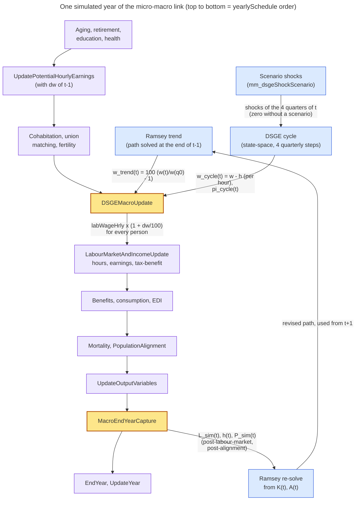

# SimPaths Coupling: the Java Side of the Macro Layer

This document describes the Java runtime of the macro layer (`simpaths.model.macro`). The MATLAB/Dynare model
is described in `Technical_Documentation_Macromodel.md`, the contracts between the two sides in
`Integration_Contracts.md`, both in this folder.

---

## 1. Executive Summary

The macro stack has two orthogonal layers:
- **Ramsey growth model (trend layer):** long-run structural path, re-solved each year against the
  employment, hours and population SimPaths realized (§8.1; always on with a Ramsey layer)
- **DSGE state-space model (cycle layer):** quarterly cycle dynamics driven by exogenous shocks only. It is
  one-way: it hands SimPaths the cycle wage and takes no input from SimPaths

```
SimPaths population projection ----------------> Ramsey trend model (trend layer: workers N, consumers P)
SimPaths realized employment, hours, population --> Ramsey trend model (yearly re-solve, always on, §8.1)
Scenario shocks (mm_dsgeShockScenario) -> DSGE cycle model (quarterly state-space)
SimPaths receives: w_total = 100 ((1 + w_trend/100) exp(w_cycle/100) - 1) (§3.2), delta_pi = delta_pi_cycle
```

### Design principles

1. Opt-in macro layer via `mm_macroModel` (default `off`)  
2. Macro model provides trend (Ramsey growth model) and cycle (DSGE) decomposition; the two layers are selected together by `mm_macroModel`: `off | ramsey | dsge | ramsey_dsge`
3. SimPaths applies one wage, the trend wage's level times the cycle's factor, both measured on the wage per hour (§3.2)
4. The DSGE takes no input from SimPaths. SimPaths' labour supply reaches the macro side through the planner alone, counted once a year after the labour market and the population alignment (§4, §7.1).
5. Path recording is completely decoupled from the macro model usage (controlled via `mm_useMacroPathRecorder`, default `true`).
6. Realized employment, hours and population are fed back into the Ramsey re-solve whenever a Ramsey layer runs, with one persistence `mm_ramseyFeedbackPersistence` (default `1.0`) for all three.

How the macro wage enters SimPaths' wage equation is in §3.3, the order of events within a simulated year and
across a run in §4, and what the feedback assumes about employment and population in §8.1.

---

## 2. Architecture

### 2.1 Entry and orchestration

- Main integration orchestration: `simpaths.model.macro.MacroModelManager`
- Simulation manager bridge: `simpaths.model.SimPathsModel`
- Dynamic policy evaluator: `simpaths.model.macro.DSGEModel`
- Labour-supply aggregation for the planner's feedback and the level diagnostics: `simpaths.model.macro.LaborSupplyAggregator`

### 2.2 Bundle files consumed

Under `input/{COUNTRY}/MacroModel/` (the bundle the MATLAB exporters write), or the folder `mm_macroBundleDir`
names (§6.1):

- DSGE layer: `policy_A.csv`, `policy_Bs.csv`, `policy_C.csv`, `policy_D.csv`, `shock_params.csv`,
  `model_info.json`
- Ramsey layer: `growth_params_{COUNTRY}.json`, `growth_terminal_state.json`,
  `growth_model_reference_{country}.csv`, `hours_projection_{COUNTRY}.csv` (the forward hours path, §8.1)
  and `population_projection_{COUNTRY}.csv` (`time,N,P`: the forward paths of persons in employment and of
  the resident population, both from SimPaths' own population workbook). The run fails if either projection
  is missing, rather than extrapolating historical growth, and if the population projection or the reference
  CSV lacks the `P` column (contract 42).
- Scenarios: `_macroScenario_*.csv`, named by `mm_dsgeShockScenario` / `mm_ramseyScenario`. They are
  maintained by hand; no exporter writes them. `mm_dsgeShockScenario` is read from this folder. The
  `mm_ramseyScenario` file is looked up first in the active input scenario folder (`inputScenario`,
  `input/{CC}/scenarios/<name>/`), then in this folder; the log line `Loaded Ramsey scenario from:` names the
  file used. With an active input scenario, a name found in neither folder fails, naming both; without one, the
  file is read from this folder only, and a missing file fails, naming its path in this folder.

In the bundle but not read at runtime: `steady_state.csv` (the exported model is log-linearised, so every
steady state is zero; kept for inspection), `irfs_eps_*.csv` (read by `DSGEIrfParityTest` and
`CommittedBundlesTest`), `policy_full_gh{u,x}.csv` (for reference; nothing reads them),
`SIMPATHS_INTERFACE.md` (a human-readable summary) and `BUNDLE_PROVENANCE.txt`
(checked by `BundleProvenanceTest`, contract 18). A bundle holding `BUNDLE_NOT_VERIFIED.txt` is refused at
startup.

### 2.3 Ramsey growth input contract

The Ramsey trend layer reads country-specific growth inputs from `growth_params_*.json` together with
`growth_terminal_state.json` and `growth_model_reference_*.csv`.

For TFP growth, `growth_params_*.json` carries `tfp_growth_annual` and an optional `terminal_growth` object:

- Without the object, or with `enabled: false`, the baseline TFP growth rate is `tfp_growth_annual` throughout.
- With `enabled: true`, SimPaths treats `tfp_growth_annual` as the in-sample calibration growth rate and lets it
	converge quarter by quarter toward `terminal_growth.g_A_terminal_annual` at the rate
	`terminal_growth.rho_quarterly` (0.99 when the key is absent).

Every country's template carries the same block, a common long-run rate reached with a half-life of 5 years
(`Technical_Documentation_Macromodel.md` §2.3):

```json
"terminal_growth": {
	"enabled": true,
	"g_A_terminal_annual": 0.005,
	"rho_quarterly": 0.966
}
```

---

## 3. Coupling Contract

### 3.1 SimPaths -> DSGE inputs

None. The DSGE takes no input from SimPaths: its annual step (`DSGEModel.stepAnnual(DSGEShockScenario, int)`,
called from `MacroModelManager.runDsgePass`) receives the scenario's shocks for the year and nothing else, all
zero without a scenario. `eps_L` and `eps_h` are shocks of the model like the others, which a scenario may set.
SimPaths' labour supply reaches the macro side through the planner's end-of-year feedback alone (§8.1).

The reason is that nothing SimPaths produces is a business-cycle movement: its workers move with ageing, reforms,
alignment and sampling noise, and those movements reach the planner. Feeding them to the DSGE as well would count
one movement twice, in the trend wage and in the cycle wage.

### 3.2 DSGE -> SimPaths outputs

- `w_trend`: the planner's wage per hour of all persons in employment, `(1-alpha) Y / (N h)`, in percent against
  the handoff quarter (§3.3).
- `w_cycle`: the DSGE's wage per hour, `w - h`, averaged over the four quarters of the year: a 100·log deviation
  from that year's trend wage (`DSGEState.getHourlyWageDeviation`). The DSGE's own `w` is the bargained wage per
  worker, which hours per worker raise (`MULTI_COUNTRY_WORKFLOW.md`, sign checks); net of `h` it is the wage
  per hour, the concept of the trend wage and of the wages SimPaths multiplies. After a positive hours shock `w`
  rises slightly while `w - h` falls.
- `w_total = 100 ((1 + w_trend/100) exp(w_cycle/100) - 1)`: the trend wage's level times the cycle's factor, in
  percent against the handoff quarter (`TrendCycle.totalPct`, contract 40). A cycle therefore keeps its size
  however far the trend has moved. The sum of the two percentages would measure the cycle against the
  handoff-quarter wage instead of the trend wage of the year and shrink it by `1 / (1 + w_trend/100)`: on the
  Poland setup `w_trend` is about +42% by 2040 (one seed, 2026-11-06), which would leave the cycle at 0.7 of its
  size. Without scenario shocks `w_cycle = 0` and `w_total = w_trend` exactly.
- `delta_pi`: inflation deviation (%) (cycle component), recorded only (§4.5).

SimPaths multiplies every potential wage by `1 + w_total / 100` (§3.3).

### 3.3 How the macro wage enters SimPaths, and how that differs from the `wage_growth` index

**Macro model on: one scalar, applied as a multiplier.** Once a year, at `DSGEMacroUpdate` (after union
matching and fertility, before `LabourMarketAndIncomeUpdate`; §4), `MacroModelManager.updateEquilibrium` sets a
single number, the wage deviation `dw` in percent:

| `mm_macroModel` | `dw` |
|---|---|
| `ramsey` | `w_trend(t) = 100 (w(t) / w(q0) - 1)`: the Ramsey trend wage `w = (1-alpha) Y / (N h)`, averaged over the four quarters of year `t`, relative to the handoff quarter `q0`, the first quarter of the start year (`advanceRamseyTrend`). A cumulative level against the start, not a growth rate; already nonzero in the start year |
| `dsge` | `100 (exp(w_cycle(t)/100) - 1)`: the percent form of the DSGE's annual-average wage per hour `w - h`, a 100·log deviation from its steady state (§3.2) |
| `ramsey_dsge` | `w_total(t) = 100 ((1 + w_trend(t)/100) exp(w_cycle(t)/100) - 1)`: the trend's level times the cycle's factor (§3.2) |

`MacroModelManager.updatePotentialHourlyEarnings` then runs `Person.updateFullTimeHourlyEarnings` for every
person:

1. the log wage from the wage regressions (`W1ma`/`W1fa` for persons not employed last year, without a lag;
   `W1mb`/`W1fb` for persons employed last year, with the lagged log wage), plus the person's random component;
2. `labWageHrlyRegression`, the exponentiated and clamped regression wage before any overlay. This is what
   `updateLaggedVariables` rolls into next year's lag, so the overlay never re-enters the wage equation's own
   AR dynamics. Rolled into the lag, the multiplier would compound every year: a Ramsey trend of about 1.9%/yr
   would be realized as about 5%/yr;
3. the wage times `1 + dw / 100`, the same multiplier for every person, whatever their skill, age, gender or
   region;
4. a clamp to `[MIN_HOURLY_WAGE_RATE, MAX_HOURLY_WAGE_RATE]`, stored as the potential hourly wage `labWageHrly`
   (`setFullTimeHourlyEarningsPotential`). The discrete-choice labour-supply model prices each hours option with
   it; earnings and the tax-benefit donor match follow from the hours chosen.

The macro wage is therefore a multiplicative overlay on the *output* of the wage equation, applied once a year
and kept out of the equation's dynamics. It is a real wage: the Ramsey wage is real, and SimPaths wages are in
`BASE_PRICE_YEAR` prices. It feeds back through the planner: the hours people choose become `L_sim` and `h`
(`LaborSupplyAggregator`), which reach the Ramsey re-solve as `delta_t` and `delta_h` at the end of the year,
together with SimPaths' population as `delta_P` (§8.1), and move next year's `dw`. They do not reach the DSGE.

**Companion switch.** Whenever the Ramsey layer runs, `Parameters.freezeWageGrowthForRamseyTrend` holds the
exogenous `wage_growth` index (below) at its last in-sample year, `Parameters.wageGrowthLastInSampleYear` (2023
for PL), so that the secular trend is not counted twice. In-sample years are untouched. `SimPathsModel` sets the
flag from `mm_macroModel.usesRamseyTrend()`.

**Macro model off: an index inside the wage equation.** There is no multiplier: step 3 is skipped and
`labWageHrlyRegression` equals `labWageHrly`. The only aggregate wage input is
the real-wage index in `input/{CC}/time_series_factor.xlsx`, sheet `wage_growth`. It is loaded into
`Parameters.upratingIndexMapRealWageGrowth`, rebased to `BASE_PRICE_YEAR` (`rebaseIndexMap`) and extended beyond
its last year at its last observed growth ratio (`extendValueTimeSeries`). It enters wages only as a regressor,
`Person.DoublesVariables.RealWageGrowth` (100 times the index), in all four wage specifications
(`real_wage_growth` in `input_processing/regression_estimates/{CC}/08_reg_wages_{CC}.do`). Its effect is the
estimated coefficient times the index, carried forward by the lag in the `W1mb`/`W1fb` equations, so its
pass-through is partial and is whatever the regression estimated. The `fixTimeTrend` / `timeTrendStopsIn*`
switches freeze the year polynomial regressors, not this index.

**The scenario-workbook variant.** `macroShocksOn`, with `macroShockPopulation`, `macroShockProductivity` and
`macroShockGreenPolicy`, swaps the `wage_growth` sheet for a path from `scenario_macro_shocks.xlsx`
(`wage_{pop}_{prod}[_green]`), together with scenario GDP, population projections and employment-share targets,
to which `ActivityAlignmentMacroShock` aligns employment. It uses the same entry point, the regressor: the path is
an index the wage equation responds to, not a wage level the model is forced to hit. `macroShocksOn` is
independent of `mm_macroModel`.

**Side by side.**

| | Macro off: exogenous index | Macro on: Ramsey / DSGE |
|---|---|---|
| Source | Excel index, extended at its last observed growth ratio | Forward-solved `w = (1-alpha) Y / (N h)`, times the factor of the optional DSGE cycle |
| Entry point | Regressor inside the wage equation | Multiplier on the equation's output |
| Pass-through | Partial, as estimated, shaped by the lag | One for one on the level, by construction |
| Heterogeneity | One index; its effect differs between the `a` and `b` specifications (`W1ma`/`W1fa` vs `W1mb`/`W1fb`) through the lag | The same multiplier for everyone |
| Feedback from SimPaths | None | `L_sim`, `h`, `P_sim` → the Ramsey re-solve → next year's wage (the DSGE takes no input) |
| Memory | The lag carries the index's effect forward, as estimated | The overlay is kept out of the lag |
| Out-of-sample trend | From the index's extension | From the Ramsey path; the index is frozen at its last in-sample year |

The exogenous index treats the aggregate wage as a covariate that the micro wage equation responds to as
estimated; the macro layer treats it as a price level that scales everyone's potential wage one for one and that
SimPaths' own labour supply moves. Out of sample the two trends would stack, hence the freeze.

**Simplifications.**

- One multiplier for everyone: the planner produces a single wage, so a macro wage change hits all workers
  equally.
- Exchangeable workers: the planner's wage is the average labour income per hour of all persons in
  employment, self-employed included, and SimPaths' wage equation is estimated on pooled employee and
  self-employment income, so both treat every hour worked as the same input.

---

## 4. Yearly Runtime Flow and Sequence of Events

A simulated year has two link points, with the labour market between them (`SimPathsModel.buildSchedule`).

At `DSGEMacroUpdate`, after union matching and fertility, before `LabourMarketAndIncomeUpdate`:

1. Advance the Ramsey trend one year along the currently solved path, giving `w_trend(t)` (Ramsey modes). From
   `startYear+2` on this requires the end-of-year feedback of `t-1` to have run; otherwise the run stops (§8.1).
2. Step the DSGE four quarters on the scenario's shocks for `t` (zero without a scenario) and average them into
   the annual cycle values `w_cycle(t)`, the wage per hour `w - h`, and `pi_cycle(t)` (DSGE modes). The step is
   the same in every year, the start year included (`MacroModelManager.runDsgePass`).
3. Combine them into `w_total`, the trend wage's level times the cycle's factor (§3.2), and apply it to every
   person's potential wage (§3.3).
4. Record the year's row, with in-year level indices that step 5 overwrites.

At `MacroEndYearCapture`, after mortality and population alignment:

5. Overwrite the year's recorded level columns with the post-alignment population and, in a Ramsey mode,
   re-solve the remaining Ramsey horizon against the realized employment, hours and population (§8.1). This is
   the one count of SimPaths' labour supply and population the macro side uses (§7.1).

Nothing is iterated within the year. The order of steps 1 and 2 does not matter for the wage: neither layer
reads the other's output within the year, and the wage is their product. The labour market of year `t` reaches wages
in `t+1` through one channel, the planner's re-solve on the post-alignment count; the DSGE never sees it.
The one dependency between the layers is conceptual: the DSGE is estimated on Ramsey-detrended data, so the
Ramsey path is its steady state, which is why `mm_macroModel: dsge` alone is diagnostic (§6.1).

### 4.1 One simulated year

Events in the order `yearlySchedule` fires them, top to bottom. Lavender boxes are SimPaths events, amber the
two link points, blue the macro layer; `dw = w_total = 100 ((1 + w_trend/100) exp(w_cycle/100) - 1)`, in percent.



### 4.2 Message sequence across a run

The start year, the yearly loop and the final export, between the SimPaths schedule and the macro layer.

```mermaid
sequenceDiagram
    autonumber
    participant S as SimPaths schedule
    participant M as MacroModelManager
    participant R as Ramsey trend
    participant D as DSGE cycle
    participant C as MacroPaths.csv

    Note over S,C: startYear (firstYearSched: no labour market, no unions, no fertility)
    S->>M: DSGEMacroUpdate
    M->>M: initialize: verify bundle, latch demographic anchors (Pop, WAP, atRisk)
    M->>D: load state-space, reset to steady state (DSGE modes; dsge alone checks the bundle's handoff quarter)
    M->>R: load bundle, solve the full forward path from (K_T, A_T) with the N, h and P projections, baseline = quarter 0 (Ramsey modes)
    M->>R: advanceRamseyTrend
    R-->>M: w_trend(startYear)
    M->>D: stepAnnual on the scenario's shocks for startYear (zero without a scenario)
    M->>S: labWageHrly x (1 + dw/100) for all persons
    M->>C: row for startYear
    S->>M: MacroEndYearCapture
    M->>C: overwrite the level columns of the startYear row (post-alignment), no feedback in the start year

    loop every year t from startYear+1 (yearlySchedule)
        Note over S: aging, retirement, education, health, UpdatePotentialHourlyEarnings (dw of t-1), unions, fertility
        S->>M: DSGEMacroUpdate
        opt Ramsey modes
            M->>M: from startYear+2: stop unless the feedback of t-1 ran
            M->>R: advanceRamseyTrend
            R-->>M: w_trend(t), from the path solved at the end of t-1
        end
        opt DSGE modes
            M->>D: stepAnnual on the scenario's shocks for t (zero without a scenario)
            D-->>M: w_cycle(t) (annual mean of w - h), pi_cycle(t)
        end
        M->>S: labWageHrly x (1 + w_total/100), w_total = trend level x cycle factor, for all persons
        M->>C: row t: trend, cycle, wage_realized and the pre-alignment level indices
        S->>S: LabourMarketAndIncomeUpdate: at-risk pool, labour-supply choice at the new wages, earnings, tax-benefit match, disposable income
        opt t = startYear+1
            S->>M: latchStartYearAnchorsPostLabourMarket: l_level and h_level anchors
        end
        Note over S: benefits, consumption, EDI, mortality, PopulationAlignment, output variables
        S->>M: MacroEndYearCapture
        M->>C: overwrite the level columns of row t with the post-alignment population
        opt Ramsey modes
            M->>M: computeRawAggregates: L_sim(t), h(t), P_sim(t)
            alt t = reference year (startYear+1 by default)
                M->>M: latch lambda = N_assumed(t)/L_sim(t), lambda_P = P_assumed(t)/P_sim(t) and the hours base
            else after the reference year
                M->>R: delta = lambda L_sim(t)/N_assumed(t), delta_h, delta_P = lambda_P P_sim(t)/P_assumed(t), rebuild the remaining paths from the original projection, re-solve from K(t), A(t), stepYear
                R-->>M: revised path, cursor at t+1
                M->>C: n_realized_gap, h_realized_gap, p_realized_gap, w_trend_revision on row t
            end
        end
        Note over S: EndYear, UpdateYear
    end
    S->>M: UpdateYear in endYear: exportPaths
    M->>C: MacroPaths.csv written
```

### 4.3 What crosses the boundary, and when

| When | Direction | What | Computed from | Consumed by | First fires |
|---|---|---|---|---|---|
| Offline (MATLAB) | micro to macro | `population_projection_{CC}.csv` (`time,N,P`: persons in employment and the resident population at the handoff quarter, both grown from the workbook, `N` with the population aged 15-64, `P` with all ages) and `hours_projection_{CC}.csv` | `input/{CC}/align_popProjections.xlsx`, the projection SimPaths' population alignment uses; the hours trend fitted to observed hours | the forward Ramsey solve | before the run |
| `DSGEMacroUpdate` | macro to micro | `w_trend(t)`, cumulative percent against the handoff quarter | the Ramsey path solved at the end of `t-1` (`advanceRamseyTrend`) | the wage multiplier | `startYear` |
| `DSGEMacroUpdate` | macro to micro | `w_cycle(t)`, the wage per hour `w - h`; `pi_cycle(t)` is computed too | the DSGE annual average after four quarterly steps on the scenario's shocks | the wage multiplier (`pi_cycle` is only recorded) | `startYear`; zero without scenario shocks |
| `DSGEMacroUpdate` | macro to micro | every person's potential wage times `1 + w_total/100`, the trend's level times the cycle's factor (§3.2) | `Person.updateFullTimeHourlyEarnings` (§3.3) | labour-supply choice, earnings, tax-benefit match | `startYear` |
| End of `LabourMarketAndIncomeUpdate` | micro to macro | the `l_level`/`h_level` start anchors, latched once (`latchStartYearAnchorsPostLabourMarket`) | the post-labour-market population | the `l_level`/`h_level` indices and the gate of `participation_rate`, `workers_over_atRiskPool` (§7.2) | `startYear+1`, once |
| `MacroEndYearCapture` | micro to macro | post-alignment level indices (`l_level`, `h_level`, `wap_level`, `cat_*`, `wage_realized`) | `computeRawAggregates` after mortality and population alignment | `MacroPaths.csv` only | `startYear` (`l_level`, `h_level` from `startYear+1`, §7.2) |
| `MacroEndYearCapture` | micro to macro | `L_sim(t)`, `h(t)`, `P_sim(t)`; the `lambda`/`lambda_P` latch, then `delta_t`, `delta_h`, `delta_P` and the Ramsey re-solve | the same post-alignment snapshot, one `computeRawAggregates` call (contract 43) | the Ramsey path from `t+1` on, hence next year's `w_trend` | `lambda`, `lambda_P` in the reference year (`startYear+1` by default, §8.1); re-solves from the year after it |
| `UpdateYear` of `endYear` | | `MacroPaths.csv` export, diagnostics summary | | | `endYear` |

### 4.4 The first years of a run

| Year | Labour market | Wage multiplier | DSGE (DSGE modes) | Ramsey feedback |
|---|---|---|---|---|
| `startYear` | none (`firstYearSched`) | `w_total`; `w_trend` already nonzero | initialised, stepped on the scenario's shocks | none |
| `startYear+1` | yes | `w_total` | stepped on the scenario's shocks | `lambda`, `lambda_P` and the hours base latched at year end, no re-solve |
| `startYear+2` | yes | `w_total` | stepped on the scenario's shocks | first gap and first re-solve at year end, effective from `startYear+3` |
| later | yes | `w_total` | the same step | yearly |

The last column holds for the default reference year, `startYear+1`. With `mm_ramseyFeedbackReferenceYear: R` the
feedback does nothing before `R`, latches at the end of `R` and has its first gap and re-solve at the end of
`R+1` (§8.1).

`w_cycle` is zero in every year without scenario shocks.

### 4.5 What does not cross

- `pi_cycle`, `r*` and the planner's output, consumption, investment and capital are computed and written to
  `MacroPaths.csv` but reach no agent (`SimPathsModel.getMm_inflationDeviation` has no caller).
- SimPaths' incomes, taxes, benefits, consumption and wealth never reach the macro side. The only micro
  quantities the planner sees are the positive-hours headcount, their mean hours and the population of all
  ages (weighted, after alignment); the working-age population, the at-risk pool, potential wages
  (`wage_realized`) and the labour-category shares (`cat_*`) are recorded only.
- Nothing from SimPaths reaches the DSGE, at any point of the year. Nothing crosses in the Ramsey direction at
  `DSGEMacroUpdate` except the already-solved path.

### 4.6 Timing facts that are easy to get wrong

- **The wage of year `t` is one period stale** with respect to the Ramsey feedback: it comes from the path solved
  at the end of `t-1`, and year `t`'s realized labour changes the wage from `t+1`. This is the extended-path
  convention, not a defect (§8.1).
- **Union matching sees last year's multiplier.** `Person.Processes.UpdatePotentialHourlyEarnings` runs before
  `DSGEMacroUpdate` and applies `dw(t-1)`; `DSGEMacroUpdate` re-runs the wage equation with `dw(t)`
  before the labour market. The random component is the same in both calls (its draw changes at most once a year,
  in `Person.update`), and of the wage covariates (in the PL specification: age, education, health, region,
  part-time, the `wage_growth` index) union matching and fertility change only one: a newly matched woman moves
  to her partner's region (`UnionMatching.localMatch`). For everyone else only the multiplier differs between
  the two calls.
- **One labour count per year.** The planner's feedback takes `L_sim(t)`, `h(t)` and `P_sim(t)` at
  `MacroEndYearCapture`, after this year's labour market, mortality and population alignment. The level
  indices written at `DSGEMacroUpdate` come from the population before the labour market and are overwritten
  at the year end; no macro quantity is computed from them.
- **The first feedback moves the wage in `startYear+3`** (§4.4): `startYear+1` latches `lambda`, `lambda_P`
  and the hours base, `startYear+2` has the first re-solve, which the wage of `startYear+3` is the first to use.
  With a reference year `R` (`mm_ramseyFeedbackReferenceYear`) the three years are `R`, `R+1` and `R+2`.
- **A missing feedback stops the run.** If the end-of-year feedback of `t-1` did not run (`t-1 > startYear`),
  `updateEquilibrium` throws before advancing the planner's trend into `t`, naming `MacroEndYearCapture`.
- **`n_ramsey` and `p_ramsey` change meaning under feedback**: after the first re-solve they track the fed-back
  paths, not the projection (§8.1).

---

## 5. Shock Conventions (Critical)

Dynare-exported policy matrices (`Bs`, `D`) contain raw `ghu` derivatives.  
Therefore input handling must be:

- Every scenario shock (`eps_a`, `eps_r`, `eps_d`, `eps_p`, `eps_L`, `eps_sep`, `eps_h`, `eps_inv`): an
  innovation in sigma-units, converted to a raw innovation by multiplying by sigma. SimPaths sends none.
- The labour force and hours follow their own AR(1) at the calibrated persistence the bundle carries
  (`shock_params.csv`; Poland 0.95 and 0.80 per quarter), like every other exogenous process, so a
  labour-force shock repeated every quarter accumulates and can trip `mm_dsgeMaxStateDeviation`.
- `model_info.json` declares the units (`deviation_scale = 100`); Java refuses a bundle that does not, with a
  message to re-export (contract 1).

Formula for every shock:

`rawInnovation_j = shockInSigmaUnits_j * sigma_j`

This matches Dynare:

`IRF(y, eps_j, t=0) = ghu(y, eps_j) * sigma_j`

---

## 6. Configuration Surface

### 6.1 Macro switches

All under `model_args`:

- `mm_macroModel` (`off | ramsey | dsge | ramsey_dsge`, default `off`; which layers run. `dsge`
  alone is diagnostic: the cycle is estimated on Ramsey-detrended observables, so without the
  trend layer it deviates around SimPaths' own wage trend instead)
- `mm_useMacroPathRecorder` (boolean, default `true`; records path regardless of `mm_macroModel`)
- `mm_dsgeShockScenario` (string; ignored unless `mm_macroModel` runs the DSGE)
- `mm_ramseyScenario` (string; ignored unless `mm_macroModel` runs the Ramsey layer; looked up in the input
  scenario folder first, then the bundle folder, §2.2). The file's parameter columns (`g_A`, `delta`, `alpha_K`,
  `beta`, `sigma`, `g_Y`, `nx_Y`) are absolute deviations of the planner's parameters; its `N` and `P` columns
  are relative deviations of the planner's workers and population from the bundle's paths (`0.012` = 1.2% more),
  which scale the paths the planner solves on (§8.1). `N` and `P` must be zero from the start year through the
  year after the feedback's reference year (`startYear + 2` by default), the years whose factors enter the
  bundle's handoff quarter or the quarters the feedback latches on; the first year a deviation may be non-zero is
  two years after the reference year (`startYear + 3` by default), and an earlier one fails at startup (§8.1).
  The planner knows the file from the start year; a run without it is the surprise case
- `mm_macroBundleDir` (string, default empty = `input/{CC}/MacroModel`; the bundle folder, against which
  the two scenario names resolve too, the Ramsey scenario only when the input scenario folder does not hold
  it. A second bundle, such as one handed off at an earlier quarter for a
  backtest, lives in its own folder because `BundleProvenanceTest` hashes only `input/{CC}/MacroModel`.
  A folder that does not exist fails a macro-on run; recorder-only runs read only `model_info.json` from it)
- `mm_dsgeMaxStateDeviation` (double, default `10.0`; DSGE stability bound in log-deviation units)
- `mm_macroLogging` (`off | state | verbose`, default `off`; `verbose` implies `state`)
- `mm_ramseyFeedbackPersistence` (double, default `1.0`, range `[0,1]`; the planner's belief about how
  persistent a realized employment, hours or population gap is — see §8.1. The feedback itself has no switch:
  it is always on with a Ramsey layer. Ignored without one)
- `mm_ramseyFeedbackReferenceYear` (int, default `0` = the year after the start year; the year against which
  the planner measures SimPaths' workers, hours and population — see §8.1. A year after the start year and
  before the end year; any other value fails at startup. The feedback does nothing before it. Ignored without
  a Ramsey layer)

Unquoted `off` is a YAML 1.1 boolean, so SnakeYAML delivers `Boolean.FALSE`; the enum parser
maps it to the disabled constant, which is why `mm_macroModel: off` works without quotes.

A key under `model_args` that is not a field of `SimPathsModel` prints a `NoSuchFieldException` stack trace and
is otherwise ignored; the run goes on. `MacroScenarioConfigTest` fails on any `mm_*` key in `config/` that is not
a field of `SimPathsModel`.

---

## 7. Labour Count and Level Anchors

### 7.1 One count per year

The macro side counts SimPaths' labour supply and population once a year, at `MacroEndYearCapture`, after the
labour market, mortality and population alignment (`LaborSupplyAggregator.computeRawAggregates`). That count, the
positive-hours headcount `L_sim(t)` (persons aged 15-64 at risk of work with positive hours), their mean hours
`h(t)` and the population of all ages `P_sim(t)` (`totalPopulation`), all weighted and all from the one call
(contract 43), is what the planner's feedback reads (§8.1) and what the year's level columns in
`MacroPaths.csv` keep. The in-year level columns written at `DSGEMacroUpdate` come from the
population before the labour market and are overwritten by the end-of-year values.

### 7.2 Anchor-year asymmetry: the level indices start to move at different points

The recorded level indices do **not** all share the same base, and they start to
move at different points in the first two years. This is by design, not a bug, and
consumers (plots, `compare_scenarios.do`) must account for it.

Cause — two latches at different schedule phases, and an end-of-year rewrite:

- **Demographic anchors** (`startTotalPop`, `startWAP`, `startAtRisk`) are latched
  *eagerly, at the start year's `DSGEMacroUpdate`* (`latchDemographicAnchors`), before
  that year's mortality and population alignment. They are labour-market-invariant
  head counts, so this is safe.
- **L/h anchors** (`startL`, `startH`) are deliberately latched *post-labour-market*,
  and only in the **second** simulation year (`latchStartYearAnchorsPostLabourMarket`),
  because `L_0`/`h_0` must use SimPaths' model-assigned hours, not the input-DB
  hours present before the first labour-market update. The same latch opens the gate
  of `participation_rate`, `workers_over_atRiskPool` and the category diagnostics
  (`LaborSupplyAggregator.isStartYearLatched`; `LevelDiagnosticsTest`). It must not be
  moved earlier.
- **End-of-year rewrite.** At `MacroEndYearCapture`, `updateLevelAggregatesPostAlignment`
  recomputes the year's level columns from the post-alignment population, against the
  same anchors (`demographicIndexUpdates`, shared with the in-year pass), so the value
  a row keeps is the end-of-year one.

Net effect for a 2023-start run (checked on two runs of 2026-10-20):

- `total_population`, `wap_level`, `atrisk_level` are anchored on the 2023 population
  before its mortality and alignment, so the **2023** row already moves: it shows what
  2023's mortality and alignment did.
- `l_level`, `h_level` are anchored after the **2024** labour market. The 2023 row has
  no value (0); the 2024 row shows what 2024's mortality and alignment did to the
  post-labour-market count; from 2025 on a row is the change since the 2024 labour
  market.
- `n_ramsey` is the planner's annual-average labour input against the handoff quarter
  (`advanceRamseyTrend`), so it is nonzero from 2023 (§8.1 for its meaning under
  feedback); `p_ramsey`, the planner's population, works the same way.

Implications:

- The "% from first year" axis means a *different base* for the groups; do not read
  the 2023 `l_level = 0`, or the 2024 value, as "labour supply did not respond": the
  first is a placeholder before L's anchor exists, the second a within-year
  composition effect.
- In `compare_scenarios.do` the macro-impact panel is a scenario−baseline
  *difference*, so the lag cancels provided both arms use identical code and
  seed (the standard requirement); the asymmetry only matters for level plots.
- If the latch ever moves, the base of `l_level`/`h_level` and the first year of
  `participation_rate` move in every run; `compare_scenarios.do` anchors on the first
  non-zero value and must be checked with it.

---

## 8. Trend Handling

- Preferred path: Ramsey trend via `mm_macroModel: ramsey`
- If `growth_params_*.json` contains `terminal_growth.enabled=true`, annual TFP growth in the forward Ramsey
	baseline converges from the calibrated in-sample rate (`tfp_growth_annual`) toward the long-run anchor
	(`g_A_terminal_annual`) at the quarterly persistence `rho_quarterly`.
- The terminal balanced-growth-path target in Java is computed from the terminal TFP growth anchor, as in the
	MATLAB export that generates the Ramsey inputs.
- Without a Ramsey layer (`mm_macroModel` `off` or `dsge`) the trend wage is `0`. A requested Ramsey layer that
	fails to initialise stops the run (`MacroModelManager.requireRamseyTrendSolved`).
- The trend is not strictly top-down: with a Ramsey layer, realized labour supply and population always feed
	back into the yearly re-solve (§8.1)

### 8.1 Recursive trend feedback (extended path)

Whenever a Ramsey layer runs, SimPaths' realized employment, hours and population are fed back into the
Ramsey trend once per simulated year, using the standard extended-path convention (re-solve the
remaining horizon from the predetermined capital state each time new information arrives). There is no
switch for it.

**Yearly mechanism.** At `MacroEndYearCapture` — after mortality and population alignment, the
only point in the year where employment is final — the realized workers `L_sim,t`, their mean hours and
SimPaths' population `P_sim,t` (all ages, weighted) are aggregated by one call of
`LaborSupplyAggregator.computeRawAggregates` (contract 43). In the **reference year**, two
level factors are latched once, `lambda = meanN_assumed / L_sim` and `lambda_P = meanP_assumed / P_sim`,
together with the hours base, and no re-solve happens that year (`delta ≡ 1` by construction). The reference
year is the first year with a post-labour-market observation, `startYear + 1` (the labour market does not run
in `startYear`), which mirrors the `startL` latch timing described in §7.2, unless
`mm_ramseyFeedbackReferenceYear` names a later year `R`. Then the feedback does nothing in the years before
`R`: the planner stays on the path of its first solve, and the gap columns of those years are `0`. A later
reference year is for a run whose first simulated years carry a transient of SimPaths' own. The level factors
turn the reference year's ratio of SimPaths' workers to the planner's path into the yardstick for every later
year, so a dip of labour supply in the first labour-market year, as in a start in the last year with alignment
targets, makes the recovery from it a lasting surprise of workers (measured for Poland on 2026-11-10, start
2023, retirement alignment off, one seed: `n_realized_gap` +6.7 in 2030 and +9.4 in 2060 with the reference
year 2024). In every later year,
`delta_t = lambda * L_sim,t / meanN_assumed(t)` and `delta_P,t = lambda_P * P_sim,t / meanP_assumed(t)`,
where `meanN_assumed(t)` and `meanP_assumed(t)` are always read from the *original* projection retained at
startup, never from a path revised in an earlier year — this is what prevents re-solve errors from
compounding across years. The remaining-horizon employment and population paths are then rebuilt from the
original projection with quarter `j` scaled by `1 + (delta_t - 1) * rho^floor(j/4)` and
`1 + (delta_P,t - 1) * rho^floor(j/4)` (`rho = mm_ramseyFeedbackPersistence`), and the model is
re-solved from `K` and `A` at the start of year `t` (predetermined, never revised), re-anchored to
the same scenario and TFP convergence phase so the terminal balanced-growth-path target keeps
converging instead of restarting. Beyond the rebuilt population path the dependency ratio stays frozen at its
last value (`Technical_Documentation_Macromodel.md` §2.3). One `stepYear()` then consumes the realized year,
leaving the solved path positioned at `t + 1`.

**A Ramsey scenario's `N` and `P`.** When `mm_ramseyScenario` has `N` or `P` columns (§6.1), the projection
retained at startup, `ramseyProjN` and `ramseyProjP`, is the bundle's paths times the scenario's factors
(`MacroModelManager.scaleByScenarioPath`), and the initial solve already runs on it. Quarter `k = 0..3` of
calendar year `y` is multiplied by `f(y)^(1 - k/4) * f(y+1)^(k/4)`, with `f(y) = 1 + N(y)` (or `1 + P(y)`): the
annual factor holds at q1, the quarters between are interpolated geometrically, and the file's last row persists
to the end of the horizon. The factors are applied to the finished paths, after the tapered tail of `N` and the
frozen dependency ratio of `P`. Provided the file's last row is no later than the year after the projection's last
quarter, the factors are constant beyond the population projection, so there `N` keeps its growth rates and `P/N`
stays frozen at the scaled ratio; a file that runs further changes both up to its last row. Both must be zero from
the start year through the year after the reference year (`startYear + 2` by default, 2025 for a 2023 start; 2029
with `mm_ramseyFeedbackReferenceYear: 2028`); a non-zero value there fails at startup with a
message naming the file, the column, the year, the reference year and the first allowed year, two years after the
reference year (`MacroModelManager.requireNoPathDeviationBeforeFirstAllowedYear`). The reason: the start year's
workers and population are the bundle's observed handoff, measured together with `K0`, and `lambda` and `lambda_P`
latch on the planner's paths in the reference year, whose quarters 2 to 4 take in the factor of the following year
through the interpolation, so a deviation in any of these years would be absorbed into the latch and the gaps could
not show a mismatch between the scenario and SimPaths. The level factors therefore latch on the bundle's paths. The
scaled paths leave the bundle's at the earliest in quarter 2 of the year after the reference year, whose quarters 2
to 4 take in part of the factor of the year after that; in general, quarters 2 to 4 of the year before a
deviation's first non-zero year already carry part of it. `meanN_assumed` and `meanP_assumed` are read from the scaled paths, so every gap measures
SimPaths' workers and population against the scenario paths, and `n_realized_gap` and `p_realized_gap` carry what
the scenario did not foresee, for example migrants who work less than its workers path assumes, or a file that
expects more arrivals than SimPaths' population workbook delivers
(`RamseyRecursiveFeedbackTest.testFeedbackLatchesAgainstTheScenarioPaths`). They also carry an offset of the
interpolation: `meanN_assumed(t)` and `meanP_assumed(t)` average the four quarters of `t`, which lie between the
factors of `t` and `t + 1`, while SimPaths' year `t` corresponds to the factor of `t` (its population follows the
workbook's value for `t`). A growing deviation therefore lowers each gap by about 3/8 of the deviation's annual
growth, from the year before its first non-zero value on; for `input/PL/scenarios/migration_200k` that is -0.2 to
-0.3 pp in the population gap and -0.3 to -0.5 pp in the workers gap from 2029 on, computed from its
`ramsey_migration.csv`. That file's `N` is the deviation of the population aged 15-64, which is known without a
SimPaths run; arrivals who work more often than the average person aged 15-64 then stay in the workers gap. The
folder's `ramsey_migration_workers.csv` has the deviation of SimPaths' own workers as `N`, read off two runs with
the macro layer off, one on the baseline inputs and one with the input scenario
(`input_processing/scenarios/build_ramsey_workers_path.do`); a foresight run names this file.
`n_ramsey` and `p_ramsey` show the scaled paths. A file whose `N` and `P` are zero
throughout leaves every planner quantity bit-identical (contract 44).

The latch takes in SimPaths' side in the same way: with an input scenario (`inputScenario`) whose workbooks already
differ from the baseline in the reference year, a run without the Ramsey scenario file (the surprise case) also absorbs
that difference into `lambda` and `lambda_P`, so its gaps show departures from the latch-year ratio only.

**One-period-stale wages.** The wage SimPaths used for year `t` was set by `advanceRamseyTrend()`
*before* this feedback step runs — it reflects the path as solved at the end of year `t-1`, not
year `t`'s own realized labour. Only `advanceRamseyTrend()` for year `t+1` steps into the revised
path. This one-period lag is the standard extended-path convention, not a defect to be closed.

**A failed solve is fatal.** If the Ramsey trend fails to solve, the run stops rather than continuing without
the feedback. The feedback is the only channel through which SimPaths' labour reaches the planner.

**A missing feedback is fatal.** `applyRamseyRecursiveFeedback` records the year it ran, and
`updateEquilibrium` refuses to advance the trend into year `t` when the feedback of `t-1` did not run
(`t-1 > startYear`), with a message naming `MacroEndYearCapture`. Advancing on a path that ignores a year of
SimPaths' labour supply would be a silent fallback. The guard is in the schedule-driven path, not in
`advanceRamseyTrend`, which tests step on their own. A non-positive realised `L` or an exhausted projection
horizon is logged as a warning and that year's re-solve is skipped; the year still counts as fed back, because
the check tests that the hook ran, not that it re-solved. Unusable hours or population (non-finite or
non-positive) leave that margin on its projection while the re-solve goes ahead; if the population is unusable
in the latch year, `lambda_P` is never latched and the population stays on the bundle's path for the run. An
unusable population is logged as a warning, so a run whose population margin is inert says so in its log.

**The DSGE takes no part.** With a DSGE mode the cycle layer runs on the scenario's shocks alone and takes no
input from SimPaths (§3.1), so the planner's feedback is the only channel from SimPaths' labour supply to the
macro side. Consequence: with no scenario shocks, a Ramsey+DSGE run has the Ramsey-only wage index year by year
on the same seed, and its cycle wage is zero (`DsgeOneWayTest`; end to end, `config/ramsey-feedback-persistent.yml`
against `config/ramsey-dsge-feedback-persistent.yml`).

**Hours feedback.** Realized mean hours per worker are fed back alongside the headcount, with the same
persistence `rho`. Heads-only feedback would show the planner `delta_n` while the labour input is `N*h`
(`RamseyTrendModel`), getting the capital-dilution response wrong whenever the two margins move in opposite
directions; an x% hours gap dilutes capital exactly as an x% headcount gap does. Diagnostic column:
`h_realized_gap`.

**The gaps use different references, and this is the subtle part.** `delta_n` is measured
against the planner's projected `N`, which is legitimate only because `extDemographic` is
overwritten at startup with the same population projection SimPaths aligns to — realized and
projected employment are then comparable and `delta_n` isolates genuine labour-market surprises.
`delta_P` is measured against the planner's projected `P` for the same reason: the bundle's population path
and SimPaths' population alignment come from the one workbook. Under the default `alignPopulation = true` the
population gap is therefore sampling noise; with the alignment off, or under a scenario that moves SimPaths'
demography rather than the workbook, it can be large. All of this holds unless an input scenario replaces
SimPaths' population workbook (see "A Ramsey scenario's `N` and `P`" above): then the gaps carry the scenario's
departure from the bundle's path, or the unforeseen part when the Ramsey scenario's `N` and `P` describe it. SimPaths' population reaches the planner every year, and
`p_realized_gap` records the gap, but under the default `rho = 1` the gap scales the whole remaining population
path, which is a pure scale, and leaves the trend wage unchanged whatever its size; the dependency-ratio effect on
the wage then comes from the bundle's population path alone. Under `rho < 1` the gap decays over the remaining
horizon, changes the time shape of `P` and moves the wage (see "What `lambda` and `lambda_P` hold fixed" below).

No equivalent reconciliation exists for hours. `projH` (read from `hours_projection_*.csv`) is a
log-linear trend fitted to observed hours per person employed (`hours_trend_method` in the growth params; for
PL, -0.17%/yr, and the `h` column of `growth_model_reference_poland.csv` is a pure exponential at that one
rate, not a data series). SimPaths models no hours trend at all, so measuring `delta_h` against `projH` would
compare two different modelling assumptions: by 2060 the planner assumes hours 5.9% below their 2024 level,
while SimPaths delivers hours about 1.3% above their 2024 level, i.e. a spurious
`delta_h` of about +7% that grows monotonically instead of mean-reverting, worth a few percent of the trend
wage at `rho=1`.

`delta_h` is therefore measured against **SimPaths' own latch-year hours** (`ramseyFeedbackHoursBase`),
not against `projH`: the planner keeps its fitted trend as a maintained assumption and SimPaths
feeds back only its own hours movements on top of it. Flat SimPaths hours give `delta_h = 1` and no
revision, which is correct, because SimPaths carries no information about the hours trend. Pinned by
`RamseyRecursiveFeedbackTest.testFlatSimPathsHoursLeaveTheDecliningProjectionAlone`, which also
asserts the fixture's hours projection really does decline so the test cannot go vacuous. Revisit
the reference if SimPaths ever gains an exogenous hours projection, e.g. an hours alignment.

**Handoff contract.** MATLAB writes `hours_projection_{COUNTRY}.csv` (single writer
`internal/write_hours_projection.m`, called by both export paths, listed in `verify_export_bundle.m`) and
`MacroModelManager.loadProjectedHours` reads it, failing loudly if it is absent. There is no local fallback:
one would let the two sides use different trailing-growth windows unnoticed. The terminal tail is built
independently on both sides; its windows are pinned by `RamseyTrendModel.TAIL_DEMOGRAPHIC_WINDOW` /
`TAIL_HOURS_WINDOW` and the tripwire in `MacroModelManagerTest`.

**Hours terminal tail.** The 600-quarter terminal tail extends hours with their trailing growth rate tapered
geometrically to zero (half-life 20 quarters), on both sides: `RamseyTrendModel.extendWithTaperedGrowth` and
`apply_smooth_terminal_demographic_closure(..., 1)` in `ramsey_trend.m`. The taper is needed because hours per
worker are constant on a balanced growth path (terminal condition `K/(kyBgp*Y) = 1`); left undamped over the
150-year tail, the fitted -0.2%/yr decline would take hours to about 69% of their handoff level. The tail is a
terminal-condition device, not a forecast; its effect on the trend wage over 2023-2060 is under 0.003%.

**Persistence (`rho`) semantics.** `rho` is the assumed persistence of a realized employment, hours or
population surprise, the same for all three, applied as a per-year geometric decay on the tail: `rho=1` treats
the whole gap as permanent (a random-walk belief in the surprise), `rho=0` replaces only the realized year and
leaves every future quarter at the originally assumed path. **`rho=0` is not a milder version of the
feedback**: with only the current year replaced, the planner still expects labour to revert next period, so a
persistent labour-supply shift never produces the capital-dilution wage response the channel exists to deliver.
On the Poland bundle (measured 2026-11-09), a +2% employment surprise with the population on its projection
revises the next year's trend wage by about **-0.55%** under `rho=1` (capital dilution, of the order
`alpha * 2%`) and by about **+0.13%** under `rho=0`: the one-year surprise raises output per head for that year
only, and the planner saves part of it, so next year's capital and wage are slightly higher.
`RamseyRecursiveFeedbackTest` checks the bands (below -0.10% and above -1.20% under `rho=1`, within ±0.25% under
`rho=0`). This is why the default is `rho=1.0`; `rho=0` is settable for comparison runs (no shipped config uses
it).

**Diagnostics.** Besides `h_realized_gap` (above), three columns are appended to all four quarterly rows of year
`t` in `MacroPaths.csv`:
`n_realized_gap` — `(delta_t - 1) * 100`, the realized gap in percent of SimPaths' workers with positive hours
against the planner's assumed employment path;
`p_realized_gap` — `(delta_P,t - 1) * 100`, the gap in percent of SimPaths' population (all ages, weighted,
after alignment) against the planner's assumed population path; and
`w_trend_revision` — the percent change in the year-`t+1` trend wage caused by the re-solve. All three
default to `0` for any year with no re-solve: the years before the reference year, the reference year itself
(the two gaps are legitimately `0` there, since `delta ≡ 1`; `w_trend_revision` is `0` because no re-solve
happens to produce a revision) and every year of a run without a Ramsey layer.

**`n_ramsey` and `p_ramsey` change meaning under feedback.** `advanceRamseyTrend` derives the `n_ramsey` and
`p_ramsey` columns (§7.2) from the *currently solved* trend's `ts.labor()` and `ts.population()`, so once a
re-solve has happened they track the fed-back, revised paths — not the population-projection-based paths they
represent before the first re-solve. The measures of how far a run departed from the assumed paths are
`n_realized_gap` and `p_realized_gap`, not `n_ramsey` and `p_ramsey`. `c_trend` and `inv_trend` are indexed to
each run's own quarter-0 consumption and investment, which differ between runs whose planner knows different
futures; compare runs through `c_ramsey_level` and `inv_ramsey_level` (§9.1).

**What `lambda` and `lambda_P` hold fixed.** The planner's `N` and SimPaths' workers are the same concept, all
persons in employment: SimPaths' labour-supply model includes the self-employed (`Les_c4.EmployedOrSelfEmployed`)
and carries no status in employment, and the planner's `N` is national-accounts total employment. The planner's
`P` and SimPaths' population are both the resident population of all ages. Both level factors are therefore
units conversions, national-accounts thousands of persons against a weighted sample count, with one concept
difference left in `lambda`: SimPaths' workers are persons aged 15-64 at risk of work with positive hours
(`LaborSupplyAggregator.computeRawAggregates`), while national-accounts employment has no upper age, so `lambda`
also holds the latch-year share of workers past 64 fixed, and a scenario that moves work past 64, such as later
retirement, does not reach the planner through the feedback. The level of `P` is a pure scale
(`Technical_Documentation_Macromodel.md` §2.1): scaling the planner's whole remaining population path by a
constant leaves capital, output, aggregate consumption and the wage unchanged. Under `rho=1` a population gap
scales the whole remaining path, so it leaves the trend wage unchanged whatever its size
(`RamseyRecursiveFeedbackTest.testUniformPopulationSurpriseIsNeutral`). Workers move the wage through capital per
worker whatever the population does: under `rho=1` a +2% worker gap revises the wage by the same -0.55% whether
the population is 2% above its path or on it (`testWorkerAndPopulationSurpriseTogetherStillDiluteCapital`). A
population gap moves the wage only by changing the time shape of the population path, as it does under `rho < 1`,
where it decays over the remaining horizon.
The dependency-ratio channel itself comes from the bundle's projected population path (`Technical_Documentation_Macromodel.md`
§2.6).

**What the feedback assumes about the labour market.** With the feedback on, the coupled model's labour market
clears through the wage, with a one-period lag. SimPaths has no unemployment state (`Les_c4` knows `NotEmployed`,
`Student` and `Retired`, nothing finer) and no rationing: whoever chooses positive hours works them and earns the wage, and
incomes, taxes, benefits and poverty are computed on that basis. The planner's realized labour input is
`lambda * L_sim(t)` exactly, and the trend wage is the marginal product of labour at that quantity, revised one
year later through capital dilution. A change in SimPaths' labour supply is therefore an employment change,
dampened by the trend-wage response it triggers through SimPaths' own wage elasticity: labour demand shows up as
that wage response, not as unemployment. This is accepted as the design of the trend layer and is the standard
assumption for one; long-run unemployment is set by institutions, which TFP and demographics do not pin down.
Three consequences:

- The *level* of `L_sim` reflects the unemployment of the estimation period, because the labour-supply model is
  estimated on observed hours and its zero-hours category contains the sample-period unemployed; `lambda` holds
  that level relationship fixed. *Changes* in `L_sim` are supply responses.
- There is no NAIRU wedge: realized labour supply is fed back directly, without an exogenous
  `N = L (1 - u*)` adjustment. The NAWRU series `ramsey_trend.m` builds is kept for diagnostics only.
- Unemployment exists only in the DSGE layer (search and matching, `U = L - N`), where it is cyclical and
  mean-reverting, and driven by the scenario's shocks alone.

The diagnostics follow the code's naming: "employment" in `n_realized_gap` and in the log lines means SimPaths'
workers with positive hours, which in this market is employment.

`ramseyBaseline` (the quarter-0 anchor used for all `advanceRamseyTrend` percentage trends) is never re-latched
by this channel.

---

## 9. Outputs and Diagnostics

### 9.1 Path export

The macro paths are exported to:

- `output/{run_id}/csv/MacroPaths.csv`

One row per quarter. The DSGE's states, jumps and shocks are written as the model has them. For `w`, `y`, `c`,
`inv` and `k`, `{var}_trend` is the Ramsey trend in percent against the handoff quarter and `{var}_total` that
trend's level times the DSGE cycle's factor, `100 ((1 + trend/100) exp(cycle/100) - 1)` (`TrendCycle.totalPct`).
For the wage the cycle is the wage per hour `w - h`, so `w_total` is the wage SimPaths applies in the quarter, while
the state column `w` is the DSGE's wage per worker. `c_trend` is the planner's aggregate consumption `P c`.

The plain columns that follow are the level indices and the feedback diagnostics: `l_level`, `h_level`,
`n_ramsey`, `participation_rate`, `workers_over_atRiskPool`, `total_population`, `wap_level`, `atrisk_level`, the
`cat_*` shares and mean hours, `wage_realized`, `n_realized_gap`, `h_realized_gap`, `w_trend_revision`, then
`p_ramsey` (the planner's population against the handoff quarter, like `n_ramsey`) and `p_realized_gap` (§7.2,
§8.1). The last six columns are the planner's levels: `y_ramsey_level`, `c_ramsey_level` (aggregate consumption
`C = P c`), `inv_ramsey_level`, `k_ramsey_level`, `n_ramsey_level` (persons in employment) and `p_ramsey_level`
(resident population), taken from the annual state of the currently solved trend. They carry the bundle's units, as
in `growth_model_reference_<country>.csv`: output, consumption and investment are quarterly flows averaged over the
year, and the same annual value stands in all four quarterly rows. Unlike the `_trend` columns, they do not depend on
the run's own quarter 0, so they are what compares consumption and investment across runs. They are zero in runs
without a Ramsey layer.

### 9.2 Logging

- Year-level macro logging: `mm_macroLogging: state`
- Additional diagnostics: `mm_macroLogging: verbose`

---

## 10. Code Map

### 10.1 Main classes

`src/main/java/simpaths/model/macro/`

- `MacroModelManager.java`
- `DSGEModel.java`
- `DSGEState.java`
- `LaborSupplyAggregator.java`
- `MacroPathRecorder.java`
- `DSGEShockScenario.java`
- `RamseyTrendModel.java`
- `RamseyScenario.java`
- `TrendCycle.java` (how a trend and a cycle combine into one level, contract 40)
- `MacroCsv.java`, `MacroJson.java` (readers for the bundle's CSV and JSON files)

### 10.2 Tests

`src/test/java/simpaths/model/macro/`

`BundleProvenanceTest` (contract 18), `CommittedBundlesTest` (replays every committed bundle's IRFs and Ramsey
forward solve), `DSGEBundleContractTest`, `DSGEIntegrationTest`, `DSGEIrfParityTest`,
`DSGEModelTest`, `DSGEShockScenarioTest`, `DSGEStateTest`, `DsgeOneWayTest` (contract 38),
`LaborSupplyAggregatorTest`, `LevelDiagnosticsTest`, `MacroJsonTest`, `MacroModelManagerTest`,
`MacroPathRecorderTest`, `MacroScenarioConfigTest`, `MacroSwitchContractTest`, `MacroWageCompositionTest`
(contract 40), `RamseyRecursiveFeedbackTest`,
`RamseyScenarioTest`, `RamseyTrendModelTest` (MATLAB parity against `src/test/resources/macro/exogenous/` at
`RELATIVE_TOLERANCE = 1e-9`),
`ScenarioLoaderParityTest`. `MacroTestSupport` holds the helpers that drive a manager through the schedule.

---

## 11. References

- The macro model itself: `Technical_Documentation_Macromodel.md` (this folder)
- Contracts between the MATLAB and Java sides: `Integration_Contracts.md` (this folder)
- Running the model and re-exporting a bundle: `../README.md`
- Rules for Java changes to the macro layer: the "Macro model" section of the root `CLAUDE.md`
