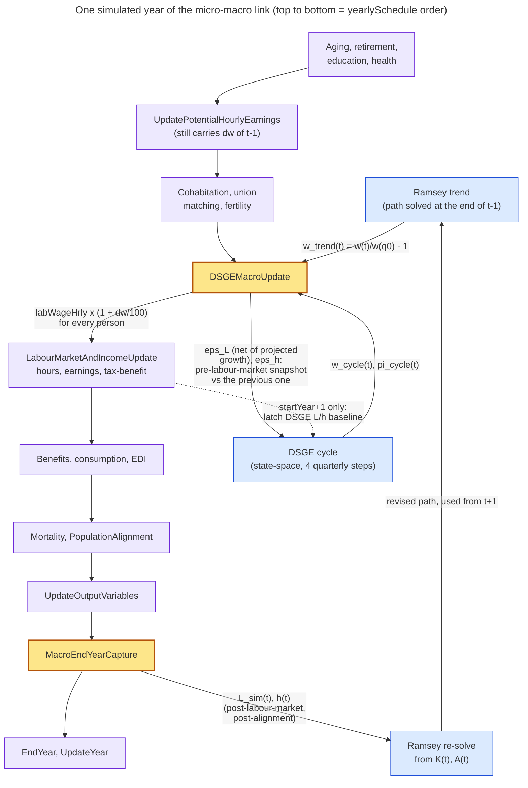
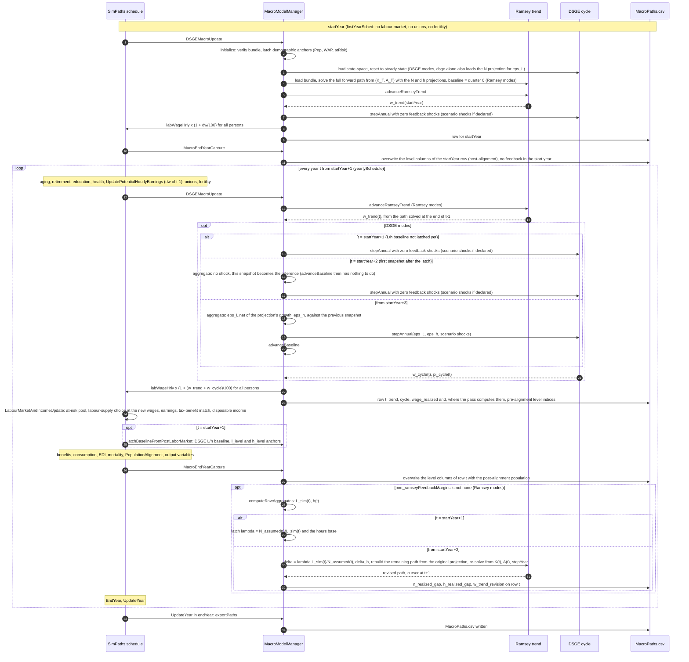

# SimPaths Coupling: the Java Side of the Macro Layer

**Status:** describes the Java runtime (`simpaths.model.macro`) as of 2026-10-20. Until 2026-10-14 this file was
`docs/DSGE_INTEGRATION_PLAN.md`. The MATLAB/Dynare model is described in
`Technical_Documentation_Macromodel.md`, the contracts between the two sides in `Integration_Contracts.md`,
both in this folder.

---

## 1. Executive Summary

This document describes the current SimPaths macro-coupling architecture.

The macro stack has two orthogonal layers:
- **Ramsey growth model (trend layer):** long-run structural path, re-solved each year against the labour
  supply SimPaths realized (§8.1; on by default)
- **DSGE state-space model (cycle layer):** quarterly cycle dynamics with annual two-way coupling to SimPaths

```
SimPaths population projection -------> Ramsey trend model (trend layer)
SimPaths realized employment, hours --> Ramsey trend model (yearly re-solve, default on, §8.1)
SimPaths labor shocks (eps_L, eps_h) -> DSGE cycle model (quarterly state-space)
SimPaths receives: delta_w_total = delta_w_cycle + delta_w_trend, delta_pi = delta_pi_cycle
```

### Current design principles

1. Opt-in macro feedback via `mm_macroModel` (default `off`)  
2. Macro model provides trend (Ramsey growth model) and cycle (DSGE) decomposition; the two layers are selected together by `mm_macroModel`: `off | ramsey | dsge | ramsey_dsge`
3. SimPaths wage application uses total wage effect (trend + cycle changes)
4. Rolling labor baseline for DSGE, i.e., DSGE sees wage _changes_ only (DSGE cannot handle arbitrary wage drift)
5. Path recording is completely decoupled from the macro model usage (controlled via `mm_useMacroPathRecorder`, default `true`).
6. Realized labour supply is fed back into the Ramsey re-solve by default, per margin, via `mm_ramseyFeedbackMargins` (default `employment_and_hours`).

How the macro wage enters SimPaths' wage equation is in §3.3, the order of events within a simulated year and
across a run in §4, and what the feedback assumes about employment in §8.1.

---

## 2. Current Architecture

### 2.1 Entry and orchestration

- Main integration orchestration: `simpaths.model.macro.MacroModelManager`
- Simulation manager bridge: `simpaths.model.SimPathsModel`
- Dynamic policy evaluator: `simpaths.model.macro.DSGEModel`
- Micro-to-macro shock aggregation: `simpaths.model.macro.LaborSupplyAggregator`

### 2.2 Bundle files consumed

Under `input/{COUNTRY}/MacroModel/` (the bundle the MATLAB exporters write):

- DSGE layer: `policy_A.csv`, `policy_Bs.csv`, `policy_C.csv`, `policy_D.csv`, `shock_params.csv`,
  `model_info.json`
- Ramsey layer: `growth_params_{COUNTRY}.json`, `growth_terminal_state.json`,
  `growth_model_reference_{country}.csv`, `hours_projection_{COUNTRY}.csv` (the forward hours path, §8.1)
  and `population_projection_{COUNTRY}.csv` (the forward `N` path from SimPaths' own demographics). The
  run fails if either projection is missing, rather than extrapolating historical growth.
- Scenarios: `_macroScenario_*.csv`, named by `mm_dsgeShockScenario` / `mm_ramseyScenario` relative to
  this folder. They are maintained by hand; no exporter writes them.

In the bundle but not read at runtime: `steady_state.csv` (the exported model is log-linearised, so every
steady state is zero; kept for inspection), `irfs_eps_*.csv` and `policy_full_gh{u,x}.csv` (read by
`DSGEIrfParityTest`), `SIMPATHS_INTERFACE.md` (a human-readable summary) and `BUNDLE_PROVENANCE.txt`
(checked by `BundleProvenanceTest`, contract 18). A bundle holding `BUNDLE_NOT_VERIFIED.txt` is refused at
startup.

### 2.3 Ramsey growth input contract

The Ramsey trend layer reads country-specific growth inputs from `growth_params_*.json` together with
`growth_terminal_state.json` and `growth_model_reference_*.csv`.

For TFP growth, the runtime supports two baseline contracts:

- Legacy contract: `tfp_growth_annual` only. In this case SimPaths uses a constant baseline TFP growth rate.
- Current contract: `tfp_growth_annual` plus an optional `terminal_growth` object. When present and enabled,
	SimPaths treats `tfp_growth_annual` as the in-sample calibration growth rate and lets it converge quarter by
	quarter toward `terminal_growth.g_A_terminal_annual` using `terminal_growth.rho_quarterly`.

Example:

```json
"terminal_growth": {
	"enabled": true,
	"g_A_terminal_annual": 0.008,
	"rho_quarterly": 0.99
}
```

This behaviour is backward compatible: if the `terminal_growth` block is absent, SimPaths falls back to the
legacy constant-growth interpretation.

---

## 3. Coupling Contract

### 3.1 SimPaths -> DSGE inputs

- `epsilon_L`: labor-force/positive-hours shock (raw log-deviation, net of the projection's own labour growth)
- `epsilon_h`: hours shock (raw log-deviation)

Both are computed by `LaborSupplyAggregator` as log deviations from the rolling baseline; `epsilon_L` additionally
subtracts the percent log change of the population projection's annual means
(`MacroModelManager.projectedLaborGrowthPct`), so it is the year-over-year change of the employment rate against
the projection, the object the DSGE was estimated on (§7.1).

### 3.2 DSGE -> SimPaths outputs

- `delta_w_cycle`: cyclical wage deviation (%) from DSGE annual aggregation
- `delta_w_trend`: secular wage trend (%) from Ramsey projection
- `delta_w_total = delta_w_cycle + delta_w_trend`
- `delta_pi`: inflation deviation (%) (cycle component)

In SimPaths wage equations, macro feedback is applied as:

`wageMultiplier = 1 + (delta_w_total / 100)`

### 3.3 How the macro wage enters SimPaths, and how that differs from the `wage_growth` index

**Macro model on: one scalar, applied as a multiplier.** Once a year, at `DSGEMacroUpdate` (after union
matching and fertility, before `LabourMarketAndIncomeUpdate`; §4), `MacroModelManager.updateEquilibrium` sets a
single number, the wage deviation `dw` in percent:

| `mm_macroModel` | `dw` |
|---|---|
| `ramsey` | `w_trend(t) = 100 (w(t) / w(q0) - 1)`: the Ramsey trend wage `w = (1-alpha) Y / (N h)`, averaged over the four quarters of year `t`, relative to the handoff quarter `q0`, the first quarter of the start year (`advanceRamseyTrend`). A cumulative level against the start, not a growth rate; already nonzero in the start year |
| `dsge` | `w_cycle(t)`: the DSGE's annual-average wage deviation from its steady state (a 100·log deviation, applied as a percent) |
| `ramsey_dsge` | `w_trend(t) + w_cycle(t)` |

`MacroModelManager.updatePotentialHourlyEarnings` then runs `Person.updateFullTimeHourlyEarnings` for every
person:

1. the log wage from the wage regressions (`W1ma`/`W1fa` for persons not employed last year, without a lag;
   `W1mb`/`W1fb` for persons employed last year, with the lagged log wage), plus the person's random component;
2. `labWageHrlyRegression`, the exponentiated and clamped regression wage before any overlay. This is what
   `updateLaggedVariables` rolls into next year's lag, so the overlay never re-enters the wage equation's own
   AR dynamics;
3. the wage times `1 + dw / 100`, the same multiplier for every person, whatever their skill, age, gender or
   region;
4. a clamp to `[MIN_HOURLY_WAGE_RATE, MAX_HOURLY_WAGE_RATE]`, stored as the potential hourly wage `labWageHrly`
   (`setFullTimeHourlyEarningsPotential`). The discrete-choice labour-supply model prices each hours option with
   it; earnings and the tax-benefit donor match follow from the hours chosen.

The macro wage is therefore a multiplicative overlay on the *output* of the wage equation, applied once a year
and kept out of the equation's dynamics. It is a real wage: the Ramsey wage is real, and SimPaths wages are in
`BASE_PRICE_YEAR` prices. It feeds back: the hours people choose become `L_sim` and `h`
(`LaborSupplyAggregator`), which reach the DSGE as `eps_L`, `eps_h` and the Ramsey re-solve as `delta_t`
(§8.1), and move next year's `dw`.

**Companion switch.** Whenever the Ramsey layer runs, `Parameters.freezeWageGrowthForRamseyTrend` holds the
exogenous `wage_growth` index (below) at its last in-sample year, `Parameters.wageGrowthLastInSampleYear` (2023
for PL), so that the secular trend is not counted twice. In-sample years are untouched. `SimPathsModel` sets the
flag from `mm_macroModel.usesRamseyTrend()`.

**Macro model off: an index inside the wage equation.** There is no multiplier: step 3 is skipped and
`labWageHrlyRegression` equals `labWageHrly`, as before the macro layer existed. The only aggregate wage input is
the real-wage index in `input/{CC}/time_series_factor.xlsx`, sheet `wage_growth`. It is loaded into
`Parameters.upratingIndexMapRealWageGrowth`, rebased to `BASE_PRICE_YEAR` (`rebaseIndexMap`) and extended beyond
its last year at its last observed growth ratio (`extendValueTimeSeries`). It enters wages only as a regressor,
`Person.DoublesVariables.RealWageGrowth` (100 times the index), in all four wage specifications
(`real_wage_growth` in `input_processing/regression_estimates/{CC}/08_reg_wages_{CC}.do`). Its effect is the
estimated coefficient times the index, carried forward by the lag in the `W1mb`/`W1fb` equations, so its
pass-through is partial and is whatever the regression estimated. The `fixTimeTrend` / `timeTrendStopsIn*`
switches freeze the year polynomial regressors, not this index.

**The older scenario variant.** `macroShocksOn`, with `macroShockPopulation`, `macroShockProductivity` and
`macroShockGreenPolicy`, swaps the `wage_growth` sheet for a path from `scenario_macro_shocks.xlsx`
(`wage_{pop}_{prod}[_green]`), together with scenario GDP, population projections and employment-share targets,
to which `ActivityAlignmentMacroShock` aligns employment. It uses the same entry point, the regressor: the path is
an index the wage equation responds to, not a wage level the model is forced to hit. `macroShocksOn` is
independent of `mm_macroModel`.

**Side by side.**

| | Macro off: exogenous index | Macro on: Ramsey / DSGE |
|---|---|---|
| Source | Excel index, extended at its last observed growth ratio | Forward-solved `w = (1-alpha) Y / (N h)`, plus the optional DSGE cycle |
| Entry point | Regressor inside the wage equation | Multiplier on the equation's output |
| Pass-through | Partial, as estimated, shaped by the lag | One for one on the level, by construction |
| Heterogeneity | One index; its effect differs between the `a` and `b` specifications (`W1ma`/`W1fa` vs `W1mb`/`W1fb`) through the lag | The same multiplier for everyone |
| Feedback from SimPaths | None | `L_sim`, `h` → `eps_L`, `eps_h` (DSGE) and the re-solve (Ramsey) → next year's wage |
| Memory | The lag carries the index's effect forward, as estimated | The overlay is kept out of the lag |
| Out-of-sample trend | From the index's extension | From the Ramsey path; the index is frozen at its last in-sample year |

The exogenous index treats the aggregate wage as a covariate that the micro wage equation responds to as
estimated; the macro layer treats it as a price level that scales everyone's potential wage one for one and that
SimPaths' own labour supply moves. Out of sample the two trends would stack, hence the freeze.

**Two defects this design encodes (do not undo).**

- *AR amplification* (fixed 2026-05-19). Before `labWageHrlyRegression` existed, the multiplied wage rolled
  into the lag, so the cumulative overlay was multiplied again every year: a trend of about 1.9%/yr was
  realized as about 5%/yr. The pre-overlay snapshot is the fix.
- *Double count* (fixed 2026-05-19). The Ramsey trend stacked on the extended `wage_growth` index. The
  out-of-sample freeze is the fix.

**Simplifications.**

- One multiplier for everyone: the planner produces a single wage, so a macro wage change hits all workers
  equally.
- The planner's wage is compensation per employee, while SimPaths' wage equation is estimated on pooled employee
  and self-employment income (§8.1, "Employees versus all workers").
- The DSGE deviation is a 100·log deviation applied as `1 + x/100`, exact only for small `x`.

---

## 4. Yearly Runtime Flow and Sequence of Events

A simulated year has two link points, with the labour market between them (`SimPathsModel.buildSchedule`).

At `DSGEMacroUpdate`, after union matching and fertility, before `LabourMarketAndIncomeUpdate`:

1. Advance the Ramsey trend one year along the currently solved path, giving `w_trend(t)` (Ramsey modes).
2. Aggregate SimPaths' labour supply and build `epsilon_L` and `epsilon_h` against the rolling baseline,
   `epsilon_L` net of the projection's labour growth (DSGE modes, §7.1).
3. Step the DSGE four quarters and average them into the annual cycle feedback `w_cycle(t)`, `pi_cycle(t)`.
4. Compose the total wage effect `w_trend + w_cycle` and apply it to every person's potential wage (§3.3).
5. Advance the rolling baseline for next year.

At `MacroEndYearCapture`, after mortality and population alignment:

6. Overwrite the year's recorded level columns with the post-alignment population and, unless
   `mm_ramseyFeedbackMargins: none`, re-solve the remaining Ramsey horizon against the realized employment and
   hours (§8.1).

No static equilibrium iteration is performed. The order of steps 1 and 3 does not matter for the wage: neither
layer reads the other's output within the year, the DSGE takes `epsilon_L` and `epsilon_h` only, the planner the
level gap only, and the wage is the sum. Both macro responses to the labour market of year `t` reach wages in
`t+1`, through two different statistics of the same headcount: the DSGE through its year-over-year change, the
planner through the cumulative gap against the projection. The one dependency between the layers is
conceptual: the DSGE was estimated on Ramsey-detrended data, so the Ramsey path is its steady state, which is
why `mm_macroModel: dsge` alone is diagnostic (§6.1).

### 4.1 One simulated year

Events in the order `yearlySchedule` fires them, top to bottom. Lavender boxes are SimPaths events, amber the
two link points, blue the macro layer; `dw = w_trend + w_cycle`, in percent.



### 4.2 Message sequence across a run

The start year, the yearly loop and the final export, between the SimPaths schedule and the macro layer.



### 4.3 What crosses the boundary, and when

| When | Direction | What | Computed from | Consumed by | First fires |
|---|---|---|---|---|---|
| Offline (MATLAB) | micro to macro | `population_projection_{CC}.csv` (the employees level at the handoff quarter, grown with the projected population aged 15-64) and `hours_projection_{CC}.csv` | `input/{CC}/align_popProjections.xlsx`, the projection SimPaths' population alignment uses; the hours trend fitted to observed hours | the forward Ramsey solve; the projection's growth also nets `eps_L` | before the run |
| `DSGEMacroUpdate` | macro to micro | `w_trend(t)`, cumulative percent against the handoff quarter | the Ramsey path solved at the end of `t-1` (`advanceRamseyTrend`) | the wage multiplier | `startYear` |
| `DSGEMacroUpdate` | micro to macro | `eps_L`, `eps_h` (100·log changes) | the positive-hours headcount and mean hours before this year's labour market, against the previous `DSGEMacroUpdate` snapshot; `eps_L` net of the projection's growth (`projectedLaborGrowthPct`) | `DSGEModel.stepAnnual` | `startYear+3`; `startYear+2` only rolls the reference (§7.1) |
| `DSGEMacroUpdate` | macro to micro | `w_cycle(t)`; `pi_cycle(t)` is computed too | the DSGE annual average after four quarterly steps | the wage multiplier (`pi_cycle` is only recorded) | labour feedback from `startYear+3`; scenario shocks from the year they declare |
| `DSGEMacroUpdate` | macro to micro | every person's potential wage times `1 + (w_trend + w_cycle)/100` | `Person.updateFullTimeHourlyEarnings` (§3.3) | labour-supply choice, earnings, tax-benefit match | `startYear` |
| End of `LabourMarketAndIncomeUpdate` | micro to macro | the DSGE's L/h baseline and the `l_level`/`h_level` start anchors, latched once | the post-labour-market population | the `l_level`/`h_level` indices (§7.2); as the shock reference it is replaced, without a shock, by the `startYear+2` snapshot | `startYear+1`, once |
| `MacroEndYearCapture` | micro to macro | post-alignment level indices (`l_level`, `h_level`, `wap_level`, `cat_*`, `wage_realized`) | `computeRawAggregates` after mortality and population alignment | `MacroPaths.csv` only | `startYear` (`l_level`, `h_level` from `startYear+1`, §7.2) |
| `MacroEndYearCapture` | micro to macro | `L_sim(t)`, `h(t)`; the `lambda` latch, then `delta_t`, `delta_h` and the Ramsey re-solve | the same post-alignment snapshot | the Ramsey path from `t+1` on, hence next year's `w_trend` | `lambda` in `startYear+1`; re-solves from `startYear+2` |
| `UpdateYear` of `endYear` | | `MacroPaths.csv` export, diagnostics summary | | | `endYear` |

### 4.4 The first years of a run

| Year | Labour market | Wage multiplier | DSGE (DSGE modes) | Ramsey feedback |
|---|---|---|---|---|
| `startYear` | none (`firstYearSched`) | `w_trend` only, already nonzero | initialised, stepped without a labour shock | none |
| `startYear+1` | yes | `w_trend` only | stepped without a labour shock; reference headcount and hours latched after the labour market | `lambda` latched at year end, no re-solve |
| `startYear+2` | yes | `w_trend` only (the cycle stays at zero unless a scenario declares shocks) | reference rolled to the pre-labour-market snapshot, no labour shock | first gap and first re-solve at year end, effective from `startYear+3` |
| `startYear+3` | yes | `w_trend + w_cycle` | first live `eps_L`, `eps_h` (before the labour market) | yearly |
| later | yes | both | yearly | yearly |

### 4.5 What does not cross

- `pi_cycle`, `r*` and the planner's output, consumption, investment and capital are computed and written to
  `MacroPaths.csv` but reach no agent (`SimPathsModel.getMm_inflationDeviation` has no caller).
- SimPaths' incomes, taxes, benefits, consumption and wealth never reach the macro side. The only micro
  quantities it sees are the positive-hours headcount, mean hours, and the demographic counts (population,
  working-age population, at-risk pool), and, for recording only, potential wages (`wage_realized`) and the
  labour-category shares (`cat_*`).
- Nothing crosses in the DSGE direction at `MacroEndYearCapture`, and nothing crosses in the Ramsey direction at
  `DSGEMacroUpdate` except the already-solved path.

### 4.6 Timing facts that are easy to get wrong

- **The wage of year `t` is one period stale** with respect to the Ramsey feedback: it comes from the path solved
  at the end of `t-1`, and year `t`'s realized labour changes the wage from `t+1`. This is the extended-path
  convention, not a defect (§8.1).
- **Union matching sees last year's multiplier.** `Person.Processes.UpdatePotentialHourlyEarnings` runs before
  `DSGEMacroUpdate` with `dw(t-1)` still in place; `DSGEMacroUpdate` re-runs the wage equation with `dw(t)`
  before the labour market. The random component is the same in both calls (its draw changes at most once a year,
  in `Person.update`), and of the wage covariates (in the PL specification: age, education, health, region,
  part-time, the `wage_growth` index) union matching and fertility change only one: a newly matched woman moves
  to her partner's region (`UnionMatching.localMatch`). For everyone else only the multiplier differs between
  the two calls.
- **`eps_L` is a pre-labour-market snapshot.** At `DSGEMacroUpdate` the hours on persons are last year's choices
  on this year's population (after aging, retirement, deaths and new entrants). `eps_L(t)` therefore carries the
  labour-market outcome of `t-1` plus demographic turnover, net of the growth the projection already assumes,
  not the choice made in `t`.
- **Two labour snapshots per year.** The DSGE uses the pre-labour-market snapshot, the Ramsey feedback the
  post-alignment one at `MacroEndYearCapture`. They differ by what this year's labour market, mortality and
  population alignment did in between.
- **No labour feedback in the first years** (§4.4): the start year gets the trend wage only, `startYear+1`
  latches both references, `startYear+2` has the first Ramsey re-solve and rolls the DSGE reference, and
  `startYear+3` has the first DSGE labour shock.
- **`n_ramsey` changes meaning under feedback**: after the first re-solve it tracks the fed-back path, not the
  projection (§8.1).

---

## 5. Shock Conventions (Critical)

Dynare-exported policy matrices (`Bs`, `D`) contain raw `ghu` derivatives.  
Therefore input handling must be:

- `epsilon_L`, `epsilon_h` from SimPaths: raw log-deviations, no scaling
- Other scenario shocks (`eps_a`, `eps_r`, `eps_d`, `eps_p`, `eps_sep`, `eps_inv`): interpreted as sigma-units and converted to raw innovations by multiplying by sigma

Formula for non-`epsilon_L/epsilon_h` shocks:

`rawInnovation_j = shockInSigmaUnits_j * sigma_j`

This matches Dynare:

`IRF(y, eps_j, t=0) = ghu(y, eps_j) * sigma_j`

---

## 6. Configuration Surface (Current)

### 6.1 Supported macro switches

All under `model_args`:

- `mm_macroModel` (`off | ramsey | dsge | ramsey_dsge`, default `off`; which layers run. `dsge`
  alone is diagnostic: the cycle was estimated on Ramsey-detrended observables, so without the
  trend layer it deviates around SimPaths' own wage trend instead)
- `mm_useMacroPathRecorder` (boolean, default `true`; records path regardless of `mm_macroModel`)
- `mm_dsgeShockScenario` (string; ignored unless `mm_macroModel` runs the DSGE)
- `mm_ramseyScenario` (string; ignored unless `mm_macroModel` runs the Ramsey layer)
- `mm_dsgeMaxStateDeviation` (double, default `10.0`; DSGE stability bound in log-deviation units)
- `mm_macroLogging` (`off | state | verbose`, default `off`; `verbose` implies `state`)
- `mm_ramseyFeedbackMargins` (`none | employment | hours | employment_and_hours`, default
  `employment_and_hours`; which realized margins enter the yearly Ramsey re-solve — see §8.1.
  Inert without the Ramsey layer)
- `mm_ramseyFeedbackPersistence` (double, default `1.0`; persistence of the realized employment gap in the feedback belief, range `[0,1]` — see §8.1)
- `mm_ramseyFeedbackHoursPersistence` (double, default `1.0`; persistence of the realized hours gap, range `[0,1]`)

Unquoted `off` is a YAML 1.1 boolean, so SnakeYAML delivers `Boolean.FALSE`; the enum parser
maps it to the disabled constant, which is why `mm_macroModel: off` works without quotes.

### 6.2 Removed legacy switches

The following are removed from active code/config:

- `mm_staticIntegration`
- `mm_maxIterations`
- `mm_convergenceTolerance`
- `mm_shockRelaxation`
- `mm_dampingFactor`
- `mm_capitalShareAlphaK`
- `mm_capitalPartialAdjustment`

---

## 7. Baseline Strategy

### 7.1 Rolling baseline

Shocks are always year-over-year, and `epsilon_L` is measured against the projection:

- `epsilon_L,t = 100 [ln(L_t / L_{t-1}) - ln(N_proj,t / N_proj,t-1)]`
- `epsilon_h,t = 100 ln(h_t / h_{t-1})`

`N_proj` is the retained original population projection (`ramseyProjN`, annual means), the same path the
Ramsey feedback gap is measured against (§8.1); `epsilon_L` is the first difference of that gap. The DSGE was
estimated on `L` net of its demographic trend (`detrended.L = 100 (ln L - ln L_demo)` in `ramsey_trend.m`);
handing it the raw change of the headcount gave it the whole projected workforce decline as a standing shock
(about -0.85%/yr for Poland against -0.89%/yr projected, measured 2026-10-20) while the trend layer already
priced that decline. Hours are not detrended: SimPaths has no hours trend and the planner's hours trend is
kept out of the feedback. `mm_macroModel: dsge` loads the projection for this purpose alone
(`loadProjectionForLaborShock`), aligned on the handoff quarter like the trend layer, and fails without it or
with a start year other than the handoff year.

This keeps shocks in the local-linear range and avoids secular drift overwhelming the DSGE approximation.

**Snapshot timing.** The baseline is latched after the labour market of `startYear+1`
(`latchBaselineFromPostLaborMarket`), but every later aggregate is taken at `DSGEMacroUpdate`, before the
year's labour market. The first aggregate after the latch (`startYear+2`) would therefore compare a
pre-labour-market snapshot with a post-labour-market one and report the year's gross outflow (retirements,
deaths, entrants without hours) as a labour-supply shock (-3.4% in every DSGE run before 2026-10-20). That call
now reports no shock and rolls the baseline to its own snapshot (`LaborSupplyAggregator.aggregate`); the first
live `epsilon_L` is in `startYear+3`. Pinned by `LaborSupplyAggregatorTest` and, end to end through
`updateEquilibrium`, by `LaborShockProjectionTest`.

### 7.2 Anchor-year asymmetry: L/N lag the demographic indices by one year

The recorded level indices do **not** all share the same base year, and `l_level`
(and `n_ramsey`) are exactly zero for the first **two** recorded years, not one.
This is by design, not a bug, and consumers (plots, `compare_scenarios.do`) must
account for it.

Cause — two latches at different schedule phases:

- **Demographic anchors** (`startTotalPop`, `startWAP`, `startAtRisk`) are latched
  *eagerly, pre-labour-market, in the first simulation year* (`latchDemographicAnchors`).
  They are labour-market-invariant head counts, so this is safe and makes
  `total_population` / `wap_level` / `atrisk_level` correct from year 1
  (start year = 0, first real move in year 2).
- **L/h anchors** (`startL`, `startH`) are deliberately latched *post-labour-market*,
  and only in the **second** simulation year (`latchBaselineFromPostLaborMarket`),
  because `L_0`/`h_0` must use SimPaths' model-assigned hours, not the input-DB
  hours present before the first labour-market update. This is the same
  correctness constraint that protects `eps_L` and the MATLAB↔Java
  `growth_model_reference` parity, so it must not be moved earlier.

Because the recorder samples at the pre-labour-market macro event, the year-2
sample is taken before `startL` is set that tick, so `l_level` is skipped (0) in
years 1 and 2; the first non-zero `l_level` is year 3. Net effect for a
2023-start run:

- `Pop`/`WAP`/`atRisk` are indexed to **2023** (first move 2024).
- `L`/`N` are indexed to **2024** (first non-zero 2025); 2023 and 2024 are both
  exactly 0.

Implications:

- The "% from first year" axis means a *different base year* for the two groups;
  do not read the 2024 `l_level=0` as "labour supply did not respond" — it is a
  placeholder before L's baseline exists.
- In `compare_scenarios.do` the macro-impact panel is a scenario−baseline
  *difference*, so the lag cancels provided both arms use identical code and
  seed (the standard requirement); the asymmetry only matters for level plots.
- If this ever needs to change, re-sampling L for the recorder after the
  labour market is parity-sensitive (eps_L, cumulative trend,
  `growth_model_reference`) and requires full parity re-validation.

---

## 8. Trend Handling

- Preferred path: Ramsey trend via `mm_macroModel: ramsey`
- If `growth_params_*.json` contains `terminal_growth.enabled=true`, the forward Ramsey baseline no longer assumes
	permanently constant TFP growth. Instead, annual TFP growth converges from the calibrated in-sample rate
	(`tfp_growth_annual`) toward the long-run anchor (`g_A_terminal_annual`) at the quarterly persistence
	`rho_quarterly`.
- The terminal balanced-growth-path target in Java is computed from the terminal TFP growth anchor, not from a
	zero-growth shortcut. This keeps SimPaths aligned with the MATLAB export contract used to generate the Ramsey
	inputs.
- If Ramsey trend is unavailable, secular wage trend fallback is currently `0` (no reduced-form alpha/gamma fallback)
- With `mm_ramseyFeedbackMargins: none` the trend is strictly top-down. The default, `employment_and_hours`,
	feeds realized labour supply back into the yearly re-solve (§8.1)

### 8.1 Recursive trend feedback (extended path)

With `mm_ramseyFeedbackMargins` set to a margin, SimPaths' realized labour supply is fed back into the
Ramsey trend once per simulated year, using the standard extended-path convention (re-solve the
remaining horizon from the predetermined capital state each time new information arrives).

**Yearly mechanism.** At `MacroEndYearCapture` — after mortality and population alignment, the
only point in the year where employment is final — realized labour force
`L_sim,t` is aggregated by `LaborSupplyAggregator.computeRawAggregates`. In the first year with a
post-labour-market observation (`startYear + 1`; the labour market does not run in `startYear`), a
level factor `lambda = meanN_assumed / L_sim` is latched once and no re-solve happens that year
(`delta ≡ 1` by construction) — this mirrors the `startL` latch timing described in §7.2. In every
later year, `delta_t = lambda * L_sim,t / meanN_assumed(t)`, where `meanN_assumed(t)` is always
read from the *original* projection retained at startup, not from any previously revised path —
this is what prevents re-solve errors from compounding across years. The remaining-horizon labour
path is then rebuilt from the original projection with quarter `j` scaled by
`1 + (delta_t - 1) * rho^floor(j/4)` (`rho = mm_ramseyFeedbackPersistence`), and the model is
re-solved from `K` and `A` at the start of year `t` (predetermined, never revised), re-anchored to
the same scenario and TFP convergence phase so the terminal balanced-growth-path target keeps
converging instead of restarting. One `stepYear()` then consumes the realized year, leaving the
solved path positioned at `t + 1`.

**One-period-stale wages.** The wage SimPaths used for year `t` was set by `advanceRamseyTrend()`
*before* this feedback step runs — it reflects the path as solved at the end of year `t-1`, not
year `t`'s own realized labour. Only `advanceRamseyTrend()` for year `t+1` steps into the revised
path. This one-period lag is the standard extended-path convention, not a defect to be closed.

**Mutual exclusions.** The feedback is fatal (rather than silently self-disabling) if the Ramsey
trend fails to solve. (Until 2026-10-20 it also refused the endogenous-labour Ramsey bundle, whose
participation FOC approximated the same response ex ante; that variant was removed,
JuergenWiemers/SimPathsEU#28, so the feedback is the only labour channel into the planner.)

A DSGE mode was also fatal until 2026-08-18; it now only warns. The two channels do not
measure the same object: `eps_L` is a *year-over-year* log change against a rolling baseline, net of the
projection's growth (§7.1), while `delta_t` is a *cumulative level* ratio against the same fixed original
projection; the one is the first difference of the other. A permanent labour-supply shift therefore gives `eps_L` once and zero
thereafter, the DSGE response decays back to the trend (the DSGE steady state *is* the Ramsey path),
and only the Ramsey revision persists — the overlap is a transitional overshoot while the cycle
decays, not a permanent double count. Its size is bounded by the measured loop gain of about -0.04,
i.e. a few percent of the labour response. What does remain is a different problem: at `rho=1` the
planner extrapolates *every* realized deviation as permanent, and with the DSGE on part of that
deviation is cyclical by construction. Prefer `rho < 1` when running both. Measured end to end on
2026-10-20 (one seed, both margins, `rho = 1`, no scenario shocks; `config/ramsey-feedback-persistent.yml`
against `config/ramsey-dsge-feedback-persistent.yml`, after the fix of the same day): with `eps_L` measured
against the projection it averages +0.01 over 2026-2060 (it averaged -0.85 before, the projected decline
itself), the first comparison after the latch is zero, and the cycle layer's response to SimPaths' own labour
input moves `w_total` by 0.29 pp of the index on average in absolute value (maximum 0.84 pp), with a mean of
+0.004 pp: a zero-mean wobble, no standing offset. The Ramsey-only arm is unchanged to the last digit.

**Hours feedback (the `hours` margin of `mm_ramseyFeedbackMargins`, added 2026-08-18 as a separate
switch).** On by default since 2026-08-19 (`employment_and_hours`); it was off in the four arms behind
the recursive-feedback note, which therefore report a heads-only loop. Heads-only feedback shows the
planner `delta_n` while the labour input is `N*h`, so it gets the capital-dilution response wrong
whenever the two margins move in opposite directions. When on, realized mean hours per worker are fed
back alongside headcount, with their own persistence `mm_ramseyFeedbackHoursPersistence`. The Ramsey
labour input is `N*h` (`RamseyTrendModel`), so an x% hours gap dilutes capital exactly as an x%
headcount gap does. Diagnostic column: `h_realized_gap`.

**The two gaps use different references, and this is the subtle part.** `delta_n` is measured
against the planner's projected `N`, which is legitimate only because `extDemographic` is
overwritten at startup with the same population projection SimPaths aligns to — realized and
projected employment are then comparable and `delta_n` isolates genuine labour-market surprises.
No equivalent reconciliation exists for hours. `projH` (since 2026-08-18 read from
`hours_projection_*.csv` rather than extrapolated locally) is a log-linear trend fitted to observed
hours (`hours_trend_method` in the growth params; for PL, -0.203%/yr, and the `h` column of
`growth_model_reference_poland.csv` is a pure exponential at that one rate, not a data series).
SimPaths models no hours trend at all, so measuring `delta_h` against `projH` would compare two
different modelling assumptions: by 2060 the planner assumes hours 7.0% below their 2024 level
while SimPaths delivers 1.3% above, i.e. a spurious `delta_h` near +9% that grows monotonically
instead of mean-reverting, worth roughly -2.5% of the trend wage at `rho_h=1`.

`delta_h` is therefore measured against **SimPaths' own latch-year hours** (`ramseyFeedbackHoursBase`),
not against `projH`: the planner keeps its fitted trend as a maintained assumption and SimPaths
feeds back only its own hours movements on top of it. Flat SimPaths hours give `delta_h = 1` and no
revision, which is correct, because SimPaths carries no information about the hours trend. Pinned by
`RamseyRecursiveFeedbackTest.testFlatSimPathsHoursLeaveTheDecliningProjectionAlone`, which also
asserts the fixture's hours projection really does decline so the test cannot go vacuous. Revisit
the reference if SimPaths ever gains an exogenous hours projection, e.g. an hours alignment.

**Handoff contract (2026-08-18).** The forward hours path is no longer derived on both sides. MATLAB
writes `hours_projection_{COUNTRY}.csv` (single writer `internal/write_hours_projection.m`, called by
both export paths, listed in `verify_export_bundle.m`) and `MacroModelManager.loadProjectedHours`
reads it, failing loudly if it is absent — no local fallback, because the fallback is what allowed
the two sides to use different trailing-growth windows unnoticed. The terminal tail is still built
independently on both sides; its windows are pinned by `RamseyTrendModel.TAIL_DEMOGRAPHIC_WINDOW` /
`TAIL_HOURS_WINDOW` and the tripwire in `MacroModelManagerTest`.

**Hours terminal tail (fixed 2026-08-18).** The 600-quarter terminal tail extends hours with their
trailing growth rate tapered geometrically to zero (half-life 20 quarters), on both sides:
`RamseyTrendModel.extendWithTaperedGrowth` and `apply_smooth_terminal_demographic_closure(..., 1)` in
`ramsey_trend.m`. Before, the fitted -0.2%/yr decline ran undamped for another 150 years and hours
reached ~69% of their handoff level, at odds with the terminal condition `K/(kyBgp*Y) = 1`: on a
balanced growth path hours per worker must be constant. The tail is a terminal-condition device, not a
forecast; its effect on the trend wage over 2023-2060 is under 0.003%.

**Persistence (`rho`) semantics.** `rho` is the assumed persistence of a realized employment
surprise, applied as a per-year geometric decay on the tail: `rho=1` treats the whole gap as
permanent (a random-walk belief in the surprise), `rho=0` replaces only the realized year and
leaves every future quarter at the originally assumed path. **`rho=0` is a near-zero-feedback
setting by construction, not a "weak feedback" setting**: with only the current year replaced, the
planner still expects labour to revert next period, so the announced wage for `t+1` is essentially
the marginal product of labour at *assumed* labour, and a persistent labour-supply shift never
produces the capital-dilution wage response the channel exists to deliver. Measured on this
branch, a +2% persistent employment surprise revises the next year's trend wage by **-0.5612%**
under `rho=1` (capital dilution, of the order `alpha * 2%`) versus **-0.0102%** under `rho=0` —
i.e. `rho=0` delivers essentially no feedback. This is why the default is `rho=1.0`; `rho=0` stays
settable for comparison runs (no shipped config uses it), not as a milder version of the feature.

**Diagnostics.** Besides `h_realized_gap` (above), two columns are appended to all four quarterly rows of year `t` in
`MacroPaths.csv`:
`n_realized_gap` — `(delta_t - 1) * 100`, the realized gap in percent of SimPaths' workers with positive hours
against the planner's assumed employees path (so it includes shifts in the employee share, see "Employees versus
all workers" below) — and
`w_trend_revision` — the percent change in the year-`t+1` trend wage caused by the re-solve. Both
default to `0` for any year with no re-solve: the latch year (`n_realized_gap` is legitimately `0`
there, since `delta ≡ 1`; `w_trend_revision` is `0` because no re-solve happens to produce a
revision) and every year of a run where the feedback is disabled.

**`n_ramsey` changes meaning under feedback.** `advanceRamseyTrend` derives the `n_ramsey` column
(§7.2) from the *currently solved* trend's `ts.labor()`, so once a re-solve has happened,
`n_ramsey` tracks the fed-back, revised labour path — not the population-projection-based path
`n_ramsey` represents when the feedback is off. Analysts comparing `n_ramsey` across arms of an
experiment should treat the off arm's `n_ramsey` as the assumed path and `n_realized_gap` (not the
persistent/transitory arm's own `n_ramsey`) as the measure of how far the feedback run departed
from it.

**Employees versus all workers: what `lambda` holds fixed.** The planner's `N` is employees, the
national-accounts headcount behind its wage and hours: compensation and hours exist per employee only, because
the self-employed earn mixed income, with no wage or hours attached (`make_datasets.do`, block "WHY EXCLUDE
SELF-EMPLOYED?"; the employees-concept note on `N_trend` in `ramsey_trend.m`). `L_sim` counts everyone aged 15-64
at risk of work with positive hours, employees and self-employed alike (`LaborSupplyAggregator.computeRawAggregates`):
SimPaths' labour-supply model includes the self-employed (`Les_c4.EmployedOrSelfEmployed`), its wage equation is
estimated on pooled employee and self-employment income, and it carries no person-level status in employment.
The level factor `lambda = meanN_assumed / L_sim`, latched in `startYear + 1`, is therefore a units conversion
(the population scale) times the employee share of workers in that year, and `N_planner(t) = lambda * L_sim(t)`
holds that share fixed for the rest of the run. This is accepted as a documented assumption, the same one the
DSGE calibration makes (contract 16 in `Integration_Contracts.md`): any shift in the employee share reaches the
planner as a labour-market surprise, so `n_realized_gap` includes composition shifts between employees and
self-employed, and the planner prices them like any other employment gap. The hours margin carries the same
mismatch, since `delta_h` compares the hours of all workers with a planner path in hours per employee; because it
is measured against SimPaths' own latch-year hours, only differences in how the two groups' hours move enter. The
size is bounded by how far the employee share moves over the horizon: a shift of 2 percentage points is of the
order of a 2% employment surprise. In Poland self-employment is about a fifth of employment, with a declining
agricultural component, so the shift is structural and one-directional, but small. Removing it would need either
a projected employee-share path in the bundle or a status-in-employment variable in SimPaths; neither is
implemented.

**What the feedback assumes about the labour market.** With the feedback on, the coupled model's labour market
clears through the wage, with a one-period lag. SimPaths has no unemployment state (`Les_c4` knows `NotEmployed`,
`Student` and `Retired`, nothing finer) and no rationing: whoever chooses positive hours works them and earns the wage, and
incomes, taxes, benefits and poverty are computed on that basis. The planner's realized labour input is
`lambda * L_sim(t)` exactly, and the trend wage is the marginal product of labour at that quantity, revised one
year later through capital dilution. A change in SimPaths' labour supply is therefore an employment change,
dampened by the trend-wage response it triggers through SimPaths' own wage elasticity: labour demand shows up as
that wage response, not as unemployment. This is accepted as the design of the trend layer and is the standard
assumption for one; long-run unemployment is set by institutions, which TFP and demographics do not pin down.
Three consequences:

- The *level* of `L_sim` reflects the unemployment of the estimation period, because the labour-supply model is
  estimated on observed hours and its zero-hours category contains the sample-period unemployed; `lambda` holds
  that level relationship fixed. *Changes* in `L_sim` are supply responses.
- There is no NAIRU wedge: realized labour supply is fed back directly, without an exogenous
  `N = L (1 - u*)` adjustment. The NAWRU series `ramsey_trend.m` builds is kept for diagnostics only.
- Unemployment exists only in the DSGE layer (search and matching, `U = L - N`), where it is cyclical and
  mean-reverting. With the feedback off (`none`), the planner's `N` follows the projection while `L_sim` is
  unconstrained; the distance between them is two projections that nothing reconciles, not unemployment.

The diagnostics follow the code's naming: "employment" in `n_realized_gap` and in the log lines means SimPaths'
workers with positive hours, which in this market is employment.

`ramseyBaseline` (the quarter-0 anchor used for all `advanceRamseyTrend` percentage trends) is never re-latched
by this channel.

---

## 9. Outputs and Diagnostics

### 9.1 Path export

Dynamic DSGE paths export to:

- `output/{run_id}/csv/MacroPaths.csv`

### 9.2 Logging

- Year-level macro logging: `mm_macroLogging: state`
- Additional diagnostics: `mm_macroLogging: verbose`

---

## 10. Code Map (Current)

### 10.1 Main classes

`src/main/java/simpaths/model/macro/`

- `MacroModelManager.java`
- `DSGEModel.java`
- `DSGEState.java`
- `LaborSupplyAggregator.java`
- `MacroPathRecorder.java`
- `DSGEShockScenario.java`
- `RamseyTrendModel.java`
- `RamseyScenario.java`
- `MacroCsv.java`, `MacroJson.java` (readers for the bundle's CSV and JSON files)

### 10.2 Tests

`src/test/java/simpaths/model/macro/`

`BundleProvenanceTest` (contract 18), `DSGEBundleContractTest`, `DSGEIntegrationTest`, `DSGEIrfParityTest`,
`DSGEModelTest`, `DSGEShockScenarioTest`, `DSGEStateTest`, `LaborSupplyAggregatorTest`, `MacroJsonTest`,
`MacroModelManagerTest`, `MacroPathRecorderTest`, `MacroScenarioConfigTest`, `MacroSwitchContractTest`,
`RamseyRecursiveFeedbackTest`, `RamseyScenarioTest`, `RamseyTrendModelTest` (MATLAB parity in exogenous
mode at `RELATIVE_TOLERANCE = 1e-9`), `ScenarioLoaderParityTest`

---

## 11. Migration Notes

Until 2026-10-14 this file was `docs/DSGE_INTEGRATION_PLAN.md`. It superseded older plan text that described
static equilibrium components and static-only test classes; those are removed from the code. For
historical rationale, see the repository history.

---

## 12. References

- The macro model itself: `Technical_Documentation_Macromodel.md` (this folder)
- Contracts between the MATLAB and Java sides: `Integration_Contracts.md` (this folder)
- Running the model and re-exporting a bundle: `../README.md`
- Rules for Java changes to the macro layer: the "Macro model" section of the root `CLAUDE.md`
